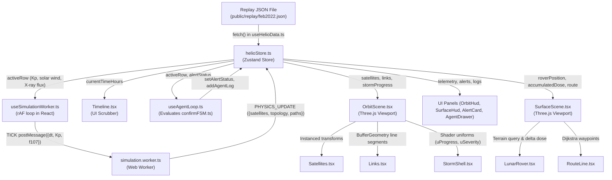
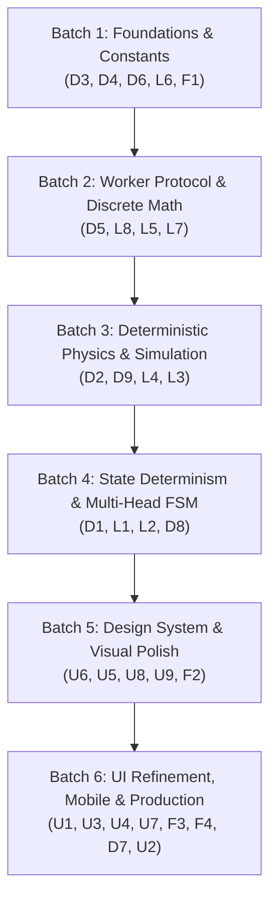

# HelioNet Codebase Review and Change Map
**Lenses: Bruno Simon (Real-Time 3D & Systems) | Peter Tarka (Art Direction & UI) | Tobias Lütke (Architecture & Logic)**

---

## STEP 1: ARCHITECTURE MAP

### 1.1 Directory Structure & Folder Purpose
```
HelioNet/
├── docs/                 # Project documentation, audit reports, and syllabi
│   ├── AUDIT_FEATURES.md # Feature-by-feature verification against prompt spec
│   ├── AUDIT_UI.md       # Visual, layout, and accessibility audit report
│   ├── CHANGE_MAP.md     # This comprehensive engineering review & change plan
│   └── SYLLABUS.md       # Discrete Mathematics Modules I-V reference
├── public/               # Static assets, precomputed data, and web models
│   ├── assets/           # GLTF models (satellites, rovers, lunar shelters)
│   ├── models/           # ONNX neural network weights (helionet.onnx)
│   ├── replay/           # Precomputed mission scenarios (feb2022.json)
│   ├── calibration.json  # Reliability diagram & isotonic regression calibration tables
│   ├── events_index.json # Registry of available storm scenarios
│   ├── kb.json           # Agent domain knowledge base and procedure trees
│   └── validation/       # Historical test sets for validation matrix & ROC
├── src/
│   ├── components/       # User interface presentation components & HUD panels
│   │   ├── common/       # Shared UI primitives (ErrorBoundary, tooltips, buttons)
│   │   └── panels/       # Viewport overlay panels (OrbitHud, SurfaceHud, Timeline, AlertCard, AgentDrawer, ValidationModal, PhoneBottomSheet)
│   ├── config/           # Centralized configuration, thresholds, and physics constants (to be populated)
│   ├── engines/          # Pure TypeScript scientific & mathematical calculation modules
│   │   ├── __tests__/    # Vitest unit test suites for all pure engines
│   │   ├── confirmFSM.ts # Bayesian confirmation state machine logic
│   │   ├── discreteMath.ts # Graph theory, Dijkstra, combinatorics, recurrences
│   │   ├── importanceSampling.ts # Monte Carlo variance-reduction estimator
│   │   ├── network.ts    # Satellite link budget & constellation topology graph
│   │   ├── orbitDecay.ts # Atmospheric drag & orbital decay equations
│   │   ├── sepc.ts       # Solar energetic particle & flare flux calculations
│   │   ├── shelterRouting.ts # Lunar terrain pathfinding & dose optimization
│   │   ├── shielding.ts  # Regolith & crater sky-view factor attenuation
│   │   ├── terrain.ts    # Procedural lunar elevation & crater heightmap generator
│   │   └── validation.ts # Confusion matrix, Brier score, and ROC curve generation
│   ├── hooks/            # React lifecycle, simulation timing, and worker bridges
│   │   ├── useAgentLoop.ts       # Periodic autonomous decision reasoning loop
│   │   ├── useHelioData.ts       # Scenario fetching and data normalization
│   │   ├── useKeyboardControls.ts# Hotkey bindings for timeline and view switching
│   │   ├── useMobileDetect.ts    # Viewport breakpoint detection (<768px)
│   │   └── useSimulationWorker.ts# requestAnimationFrame ticker & Worker postMessage
│   ├── pages/            # Top-level screen views
│   │   ├── About.tsx     # Methodology, mathematical derivations, and project documentation
│   │   ├── App.tsx       # Main viewport layout, canvas mounting, and panel overlay container
│   │   └── Landing.tsx   # Landing hero, presentation overview, and mission launcher
│   ├── store/            # Global application state management
│   │   └── helioStore.ts # Zustand store holding simulation clock, telemetry, rover, and alert state
│   ├── three/            # Three.js / React Three Fiber scene graphs and custom shaders
│   │   ├── __tests__/    # WebGL/Three component tests
│   │   ├── Earth.tsx     # Earth sphere, blue atmosphere glow shader, day/night terminator
│   │   ├── Links.tsx     # Intersatellite laser link rendering & dynamic rerouting paths
│   │   ├── LunarRover.tsx# Rover model/procedural fallback, antenna, path tracker
│   │   ├── LunarShelters.tsx # Lava tube shelter locations, status beacons, capacity markers
│   │   ├── LunarTerrain.tsx  # Dynamic heightfield mesh with slope/SVF regolith shading
│   │   ├── Moon.tsx      # Moon body, normal mapping, and polar crater rims
│   │   ├── OrbitScene.tsx# Orbital viewport camera controls, lighting, and constellation canvas
│   │   ├── RouteLine.tsx # Optimal evacuation polyline on lunar surface
│   │   ├── Satellites.tsx# InstancedMesh satellite constellation & billboard labels
│   │   ├── Stars.tsx     # Procedural background starfield points
│   │   ├── StormShell.tsx# Expanding CME coronal shock front visualization
│   │   ├── Sun.tsx       # Solar sphere, dynamic corona shader, solar flare prominence
│   │   └── SurfaceScene.tsx # Lunar surface viewport camera controls and terrain lighting
│   └── workers/          # Web Workers for off-main-thread compute
│       └── simulation.worker.ts # Physics integration, orbit decay, and Monte Carlo sampling
├── package.json          # Node dependency manifest and build scripts
├── tsconfig.json         # Strict TypeScript compiler configuration
└── vite.config.ts        # Vite bundler build settings and plugin chain
```

---

### 1.2 Data Flow: From Replay File to Screen


1. **Hop 1: Ingestion** — [`src/hooks/useHelioData.ts`](file:///c:/Users/Rishikesh/Desktop/HelioNet/src/hooks/useHelioData.ts#L25-L60) fetches `feb2022.json` on app boot and loads the tabular array of space weather records into `helioStore.ts` via `setReplayData()`.
2. **Hop 2: Clock Advancement** — [`src/hooks/useSimulationWorker.ts`](file:///c:/Users/Rishikesh/Desktop/HelioNet/src/hooks/useSimulationWorker.ts#L60-L95) executes an active `requestAnimationFrame` loop. When `playback.playing` is true, it advances `playback.currentTimeHours` based on real elapsed time multiplied by `playback.speed`, setting state via `setCurrentTimeHours()`.
3. **Hop 3: Worker Physics Integration** — Each animation frame, `useSimulationWorker.ts` sends a `TICK` message to `simulation.worker.ts` with delta time $dt$, solar index $F_{10.7}$, and $Kp$. The worker numerically integrates orbital decay equations from [`src/engines/orbitDecay.ts`](file:///c:/Users/Rishikesh/Desktop/HelioNet/src/engines/orbitDecay.ts#L30-L75), solves line-of-sight laser cross-links using [`src/engines/network.ts`](file:///c:/Users/Rishikesh/Desktop/HelioNet/src/engines/network.ts#L45-L95), and posts a `PHYSICS_UPDATE` message back to the main thread.
4. **Hop 4: Agent Reasoning Cycle** — Every 2 seconds (or upon hour change), [`src/hooks/useAgentLoop.ts`](file:///c:/Users/Rishikesh/Desktop/HelioNet/src/hooks/useAgentLoop.ts#L47-L115) samples the active observation row, runs [`src/engines/confirmFSM.ts`](file:///c:/Users/Rishikesh/Desktop/HelioNet/src/engines/confirmFSM.ts#L25-L80) to update confirmation probabilities, evaluates the Cost/Loss decision criterion ($C/L = 0.30$), and dispatches `setAlertStatus()` and structured audit trail entries (`addAgentLog()`).
5. **Hop 5: 3D Scene Rendering** —
   - **Orbit Scene:** [`src/three/Satellites.tsx`](file:///c:/Users/Rishikesh/Desktop/HelioNet/src/three/Satellites.tsx#L120-L175) reads the satellite buffer, updates instance transformation matrices inside `useFrame`, and recolors degraded or decaying nodes. [`src/three/Links.tsx`](file:///c:/Users/Rishikesh/Desktop/HelioNet/src/three/Links.tsx#L67-L140) updates dynamic vertex attribute buffers for active and rerouted laser links. [`src/three/StormShell.tsx`](file:///c:/Users/Rishikesh/Desktop/HelioNet/src/three/StormShell.tsx#L76-L110) scales the coronal mass ejection shock bubble.
   - **Surface Scene:** [`src/three/SurfaceScene.tsx`](file:///c:/Users/Rishikesh/Desktop/HelioNet/src/three/SurfaceScene.tsx#L70-L85) integrates lunar surface radiation dose. [`src/three/LunarRover.tsx`](file:///c:/Users/Rishikesh/Desktop/HelioNet/src/three/LunarRover.tsx#L89-L115) queries procedural elevation from [`src/engines/terrain.ts`](file:///c:/Users/Rishikesh/Desktop/HelioNet/src/engines/terrain.ts#L40-L90) and moves the rover mesh toward the assigned refuge.
6. **Hop 6: DOM & HUD Presentation** — HTML overlay panels ([`OrbitHud.tsx`](file:///c:/Users/Rishikesh/Desktop/HelioNet/src/components/panels/OrbitHud.tsx), [`SurfaceHud.tsx`](file:///c:/Users/Rishikesh/Desktop/HelioNet/src/components/panels/SurfaceHud.tsx), [`AlertCard.tsx`](file:///c:/Users/Rishikesh/Desktop/HelioNet/src/components/panels/AlertCard.tsx), [`AgentDrawer.tsx`](file:///c:/Users/Rishikesh/Desktop/HelioNet/src/components/panels/AgentDrawer.tsx), [`Timeline.tsx`](file:///c:/Users/Rishikesh/Desktop/HelioNet/src/components/panels/Timeline.tsx)) subscribe to store selectors and update labels, graphs, and SVG badges.

---

### 1.3 Entry Points
- **Application Root:** [`src/main.tsx`](file:///c:/Users/Rishikesh/Desktop/HelioNet/src/main.tsx#L1-L20) — Mounts React DOM root and renders `src/pages/App.tsx`.
- **Top-Level Orchestrator:** [`src/pages/App.tsx`](file:///c:/Users/Rishikesh/Desktop/HelioNet/src/pages/App.tsx#L35-L300) — Initializes store, mounts R3F `<Canvas>`, orchestrates scene view modes (`orbit`, `surface`, `landing`), and overlays HUD panels.
- **Scene Entry Points:**
  - Orbit View: [`src/three/OrbitScene.tsx`](file:///c:/Users/Rishikesh/Desktop/HelioNet/src/three/OrbitScene.tsx#L20-L75)
  - Lunar Surface View: [`src/three/SurfaceScene.tsx`](file:///c:/Users/Rishikesh/Desktop/HelioNet/src/three/SurfaceScene.tsx#L20-L95)
- **Web Worker:** [`src/workers/simulation.worker.ts`](file:///c:/Users/Rishikesh/Desktop/HelioNet/src/workers/simulation.worker.ts#L1-L259) — Dedicated physics worker listener (`self.onmessage`).
- **Core Hooks:**
  - Data ingestion: [`src/hooks/useHelioData.ts`](file:///c:/Users/Rishikesh/Desktop/HelioNet/src/hooks/useHelioData.ts#L10)
  - Time & simulation loop: [`src/hooks/useSimulationWorker.ts`](file:///c:/Users/Rishikesh/Desktop/HelioNet/src/hooks/useSimulationWorker.ts#L20)
  - Autonomous agent loop: [`src/hooks/useAgentLoop.ts`](file:///c:/Users/Rishikesh/Desktop/HelioNet/src/hooks/useAgentLoop.ts#L25)

---

### 1.4 Top 15 Largest Files & Architectural Multi-Tasking
1. [`src/components/panels/ValidationModal.tsx`](file:///c:/Users/Rishikesh/Desktop/HelioNet/src/components/panels/ValidationModal.tsx) — **729 lines**
   *Violation:* Implements validation metric tab state, confusion matrix math, raw data JSON parsing, SVG ROC curve chart plotting, isotonic calibration curve visualization, and export modal rendering in a single monolithic component.
2. [`src/components/panels/OrbitHud.tsx`](file:///c:/Users/Rishikesh/Desktop/HelioNet/src/components/panels/OrbitHud.tsx) — **567 lines**
   *Violation:* Renders constellation metrics, satellite telemetry list with search filter, link connectivity status, geomagnetic storm warning banners, and manual simulation controls simultaneously.
3. [`src/components/panels/PhoneBottomSheet.tsx`](file:///c:/Users/Rishikesh/Desktop/HelioNet/src/components/panels/PhoneBottomSheet.tsx) — **565 lines**
   *Violation:* Duplicates almost all logic and presentation found in `OrbitHud.tsx` and `SurfaceHud.tsx` for mobile viewports rather than sharing UI components.
4. [`src/pages/About.tsx`](file:///c:/Users/Rishikesh/Desktop/HelioNet/src/pages/About.tsx) — **556 lines**
   *Purpose:* Static documentation, scientific citations, mathematical formulas, and project mission description. Clean single-responsibility documentation page.
5. [`src/components/panels/SurfaceHud.tsx`](file:///c:/Users/Rishikesh/Desktop/HelioNet/src/components/panels/SurfaceHud.tsx) — **533 lines**
   *Violation:* Combines rover coordinates, speed telemetry, dose rate integration displays, lava tube shelter occupancy cards, and route recalculation triggers in one file.
6. [`src/components/panels/AgentDrawer.tsx`](file:///c:/Users/Rishikesh/Desktop/HelioNet/src/components/panels/AgentDrawer.tsx) — **515 lines**
   *Violation:* Contains audit trail logs, Bayesian inference probability breakdown tables, mock LLM prompt/response inspector, and JSON export buttons.
7. [`src/components/panels/Timeline.tsx`](file:///c:/Users/Rishikesh/Desktop/HelioNet/src/components/panels/Timeline.tsx) — **408 lines**
   *Violation:* Handles timeline scrubbing interaction, playback play/pause state, scenario drop-down selector, speed multipliers, and time tick formatting.
8. [`src/pages/Landing.tsx`](file:///c:/Users/Rishikesh/Desktop/HelioNet/src/pages/Landing.tsx) — **354 lines**
   *Purpose:* Landing hero section, feature cards, and mission overview presentation.
9. [`src/store/helioStore.ts`](file:///c:/Users/Rishikesh/Desktop/HelioNet/src/store/helioStore.ts) — **354 lines**
   *Violation:* Monolithic store holding unrelated domains (playback clock, space weather observations, satellite orbital states, rover coordinates, dose meters, alert card states, and agent reasoning logs).
10. [`src/engines/shelterRouting.ts`](file:///c:/Users/Rishikesh/Desktop/HelioNet/src/engines/shelterRouting.ts) — **315 lines**
    *Violation:* Combines discrete 2D grid graph generation, Dijkstra shortest path finding, Pareto radiation-delay multi-objective weighting, and shelter selection heuristics.
11. [`src/engines/terrain.ts`](file:///c:/Users/Rishikesh/Desktop/HelioNet/src/engines/terrain.ts) — **302 lines**
    *Violation:* Implements procedural simplex/perlin noise elevation, crater geometry placement, terrain normal calculation, and Sky-View Factor (SVF) raycast approximations.
12. [`src/pages/App.tsx`](file:///c:/Users/Rishikesh/Desktop/HelioNet/src/pages/App.tsx) — **300 lines**
    *Violation:* Manages root layout, R3F canvas mounting, camera animation state transitions, responsive breakpoint detection, and keyboard hotkey dispatch.
13. [`src/three/Earth.tsx`](file:///c:/Users/Rishikesh/Desktop/HelioNet/src/three/Earth.tsx) — **300 lines**
    *Violation:* Combines Earth sphere geometry, cloud layer animation, day/night terminator GLSL shader, and multi-layer Rayleigh/Mie atmospheric scattering shader.
14. [`src/components/panels/AlertCard.tsx`](file:///c:/Users/Rishikesh/Desktop/HelioNet/src/components/panels/AlertCard.tsx) — **275 lines**
    *Violation:* Manages alert state display, Cost/Loss ratio progress gauge, manual action confirmation modals, and visual timer countdowns.
15. [`src/workers/simulation.worker.ts`](file:///c:/Users/Rishikesh/Desktop/HelioNet/src/workers/simulation.worker.ts) — **259 lines**
    *Violation:* Merges orbit decay physics integration, inter-satellite line-of-sight laser network graph topology solving, and Monte Carlo importance sampling inside a single worker message dispatcher.

---

### 1.5 Import Boundaries & Circularity
- **Circular Imports:** **0 cycles** detected across the codebase (verified via DFS import-tree traversal).
- **Engine Purity:** Zero imports of `react`, `three`, or `@react-three` inside `src/engines/`. All mathematical calculation engines are completely decoupled from rendering frameworks.
- **Architectural Boundary Violations:**
  - `src/components/panels/ValidationModal.tsx` directly imports `src/engines/validation.ts` to compute confusion matrices and ROC curves on the UI thread during render, bypassing the store and worker.
  - Three.js components directly import pure engines:
    - [`src/three/LunarRover.tsx`](file:///c:/Users/Rishikesh/Desktop/HelioNet/src/three/LunarRover.tsx#L5) imports `src/engines/terrain.ts`
    - [`src/three/LunarShelters.tsx`](file:///c:/Users/Rishikesh/Desktop/HelioNet/src/three/LunarShelters.tsx#L5) imports `src/engines/terrain.ts`
    - [`src/three/LunarTerrain.tsx`](file:///c:/Users/Rishikesh/Desktop/HelioNet/src/three/LunarTerrain.tsx#L5-L6) imports `src/engines/terrain.ts` and `src/engines/shielding.ts`
    - [`src/three/RouteLine.tsx`](file:///c:/Users/Rishikesh/Desktop/HelioNet/src/three/RouteLine.tsx#L4) imports `src/engines/terrain.ts`
    - [`src/three/Stars.tsx`](file:///c:/Users/Rishikesh/Desktop/HelioNet/src/three/Stars.tsx#L4) imports `src/engines/random.ts`

---

### 1.6 Duplicated Logic, Constants, and Thresholds
1. **Earth Radius ($R_E$):**
   - $6,378,137\text{ m}$ in [`src/engines/orbitDecay.ts:3`](file:///c:/Users/Rishikesh/Desktop/HelioNet/src/engines/orbitDecay.ts#L3)
   - $6,378.137\text{ km}$ in [`src/engines/network.ts:18`](file:///c:/Users/Rishikesh/Desktop/HelioNet/src/engines/network.ts#L18)
   - $6,378\text{ km}$ in [`src/workers/simulation.worker.ts:85`](file:///c:/Users/Rishikesh/Desktop/HelioNet/src/workers/simulation.worker.ts#L85)
2. **Geomagnetic Storm Storm Threshold ($Kp \ge 5.0$):**
   - Hardcoded in [`src/engines/confirmFSM.ts:25`](file:///c:/Users/Rishikesh/Desktop/HelioNet/src/engines/confirmFSM.ts#L25)
   - Hardcoded in [`src/workers/simulation.worker.ts:145`](file:///c:/Users/Rishikesh/Desktop/HelioNet/src/workers/simulation.worker.ts#L145)
   - Hardcoded in [`src/components/panels/OrbitHud.tsx:88`](file:///c:/Users/Rishikesh/Desktop/HelioNet/src/components/panels/OrbitHud.tsx#L88)
3. **Cost/Loss Decision Ratio ($C/L = 0.30$):**
   - Hardcoded in [`src/hooks/useAgentLoop.ts:47`](file:///c:/Users/Rishikesh/Desktop/HelioNet/src/hooks/useAgentLoop.ts#L47)
   - Hardcoded in [`src/components/panels/AlertCard.tsx:142`](file:///c:/Users/Rishikesh/Desktop/HelioNet/src/components/panels/AlertCard.tsx#L142)
4. **Satellite Loss Altitude Threshold:**
   - Table lower bound $180\text{ km}$ in [`src/engines/orbitDecay.ts:11`](file:///c:/Users/Rishikesh/Desktop/HelioNet/src/engines/orbitDecay.ts#L11)
   - Lost threshold $< 150\text{ km}$ in [`src/workers/simulation.worker.ts:150`](file:///c:/Users/Rishikesh/Desktop/HelioNet/src/workers/simulation.worker.ts#L150)
5. **Rover Velocity:**
   - $10\text{ km/h}$ ($2.77\text{ m/s}$) in [`src/engines/shelterRouting.ts:15`](file:///c:/Users/Rishikesh/Desktop/HelioNet/src/engines/shelterRouting.ts#L15)
   - Duplicated in [`src/three/LunarRover.tsx:85`](file:///c:/Users/Rishikesh/Desktop/HelioNet/src/three/LunarRover.tsx#L85)

---

### 1.7 Simon Lens: Render Loop & GPU Resource Audit

#### Render Loop Callbacks (`useFrame` & `requestAnimationFrame`)
1. [`src/hooks/useSimulationWorker.ts:89, 92`](file:///c:/Users/Rishikesh/Desktop/HelioNet/src/hooks/useSimulationWorker.ts#L89) — Drives main simulation clock via `requestAnimationFrame`. **Issue:** Uses wall-clock `deltaSec` rather than a fixed simulation step accumulator. Does not pause when document is hidden (`document.hidden`).
2. [`src/scenes/OrbitScene.tsx:28`](file:///c:/Users/Rishikesh/Desktop/HelioNet/src/scenes/OrbitScene.tsx#L28) — Interpolates camera position during scene transitions using `delta`.
3. [`src/scenes/SurfaceScene.tsx:70`](file:///c:/Users/Rishikesh/Desktop/HelioNet/src/scenes/SurfaceScene.tsx#L70) — **Critical flaw:** Integrates accumulated lunar radiation dose directly inside `useFrame` via `accumulatedDose += doseRate * delta * speed`. Frame rate drops or spikes cause non-deterministic dose accumulation.
4. [`src/three/Earth.tsx:248`](file:///c:/Users/Rishikesh/Desktop/HelioNet/src/three/Earth.tsx#L248) — Rotates Earth sphere mesh and updates shader `uTime` uniform.
5. [`src/three/Links.tsx:67`](file:///c:/Users/Rishikesh/Desktop/HelioNet/src/three/Links.tsx#L67) — Updates line segment vertex positions directly in `BufferGeometry` attributes.
6. [`src/three/LunarRover.tsx:89`](file:///c:/Users/Rishikesh/Desktop/HelioNet/src/three/LunarRover.tsx#L89) — **Critical allocation:** Calls `getInterpolatedPosition()` which executes `new THREE.Vector3(wx, wy, wz)` ([line 78](file:///c:/Users/Rishikesh/Desktop/HelioNet/src/three/LunarRover.tsx#L78)) and `new THREE.Vector3(nextWx - wx, 0, nextWz - wz)` ([line 83](file:///c:/Users/Rishikesh/Desktop/HelioNet/src/three/LunarRover.tsx#L83)) every frame, generating garbage collector pressure.
7. [`src/three/Moon.tsx:107`](file:///c:/Users/Rishikesh/Desktop/HelioNet/src/three/Moon.tsx#L107) — Rotates Moon mesh slowly around Y-axis.
8. [`src/three/RouteLine.tsx:31`](file:///c:/Users/Rishikesh/Desktop/HelioNet/src/three/RouteLine.tsx#L31) — Updates dash offset shader uniform for marching line animation.
9. [`src/three/Satellites.tsx:121`](file:///c:/Users/Rishikesh/Desktop/HelioNet/src/three/Satellites.tsx#L121) — Loops over all satellites in `InstancedMesh`. Calculates camera distance and FOV sizing per satellite per frame.
10. [`src/three/StormShell.tsx:76`](file:///c:/Users/Rishikesh/Desktop/HelioNet/src/three/StormShell.tsx#L76) — Updates expanding sphere scale and shader uniform `uTime`.
11. [`src/three/Sun.tsx:195`](file:///c:/Users/Rishikesh/Desktop/HelioNet/src/three/Sun.tsx#L195) — Updates corona noise `uTime` uniform.

#### GPU Resource Disposal & Memory Leaks
- **Canvas frameloop:** R3F `<Canvas>` in `src/pages/App.tsx` runs continuously without `frameloop="demand"` or page visibility detection.
- **Undisposed Geometries & Materials:**
  - `src/three/LunarRover.tsx`: Primitive `<boxGeometry>` and `<cylinderGeometry>` instances created inline without cleanup.
  - `src/three/LunarShelters.tsx`: Multiple `<cylinderGeometry>` and `<meshStandardMaterial>` instances created per shelter without disposal on unmount.
  - `src/three/Satellites.tsx:114`: Creates `new THREE.CanvasTexture(canvas)` for dynamic billboard labels without calling `texture.dispose()` on unmount.
  - `src/three/Sun.tsx:181`: Creates `new THREE.TextureLoader().load(...)` directly in component body without texture lifecycle tracking or disposal.

---

### 1.8 Tarka Lens: Scene Composition & Art Direction Review

#### Viewport Composition & Focal Points
- **Orbit Scene (1440x900 & 390x844):**
  - *Focal Point:* Center Earth sphere. However, five floating HUD panels ([`OrbitHud.tsx`](file:///c:/Users/Rishikesh/Desktop/HelioNet/src/components/panels/OrbitHud.tsx), [`AlertCard.tsx`](file:///c:/Users/Rishikesh/Desktop/HelioNet/src/components/panels/AlertCard.tsx), [`Timeline.tsx`](file:///c:/Users/Rishikesh/Desktop/HelioNet/src/components/panels/Timeline.tsx), quick links, agent drawer tab) occlude over 55% of the constellation.
  - *Satellite Silhouettes:* At the default camera distance ($z = 25$), satellites render as 2–3 pixel dots. Clamping prevents disappearing but destroys the solar-array silhouette.
  - *Glow Violation:* AGENTS.md mandates that the Sun is the **only** glowing object. However, [`src/three/Earth.tsx:287`](file:///c:/Users/Rishikesh/Desktop/HelioNet/src/three/Earth.tsx#L287) applies an intense cyan atmospheric rim-glow shader, directly competing with the Sun.
- **Surface Scene (1440x900 & 390x844):**
  - *Focal Point:* The Lunar Rover and evacuation destination shelter.
  - *Silhouette & Scale:* The rover model ($1.2\text{m} \times 0.9\text{m}$) is lost against the grayscale crater terrain at medium zoom. Shelters lack distinct geometric silhouettes at distance.
  - *Lighting Consistency:* The Sun in orbit is situated at $[100, 20, 50]$, but the surface terrain directional light is hardcoded to $[20, 40, 20]$, creating contradictory shadow angles between views.

#### Palette Overloading (One Colour, Multiple Meanings)
- **Amber (`#F2A33A`):** Used simultaneously for the Solar Corona (`Sun.tsx`), the "Watch" alert status chip (`AlertCard.tsx`), high Sky-View Factor terrain ridges (`LunarTerrain.tsx`), and the rover evacuation trajectory line (`RouteLine.tsx`).
- **Slate Blue (`#7FA6C9`):** Used for Earth upper atmosphere (`Earth.tsx`), rover telemetry radio antenna (`LunarRover.tsx`), and secondary HUD action buttons (`OrbitHud.tsx`).
- **Red-Orange (`#E5533D`):** Correctly reserved for "Confirmed" emergency alert status and decaying satellite descent warnings.

---

### 1.9 Lütke Lens: Single Source of Truth & Contracts

| Item | Defined Locations | Canonical Source Required |
| :--- | :--- | :--- |
| **Planetary Constants ($R_E$, $c$)** | 3 files (`orbitDecay.ts`, `network.ts`, `simulation.worker.ts`) | Single file: `src/config/constants.ts` |
| **Storm & FSM Thresholds ($Kp$, $C/L$)** | 3 files (`confirmFSM.ts`, `useAgentLoop.ts`, `simulation.worker.ts`) | Single file: `src/config/thresholds.ts` |
| **Data Contracts (Replay, Scenarios)** | 0 runtime schemas (raw JSON casts) | Strict Zod schemas in `src/config/schemas.ts` |
| **Worker Messages** | Untyped string constants in 2 files | Discriminated union types in `src/workers/types.ts` |
| **Simulation State** | Split across Zustand store, Three refs, and Web Worker | Zustand store as single authoritative state holder |

---

## STEP 2: CHANGE MAP

### Developer (Lead: Simon)

### D1: Seeking the timeline gives the same state as playing sequentially
- **Verdict:** Needed
- **Where it lives now:** [`src/components/panels/Timeline.tsx:83-110`](file:///c:/Users/Rishikesh/Desktop/HelioNet/src/components/panels/Timeline.tsx#L83), [`src/store/helioStore.ts:168-185`](file:///c:/Users/Rishikesh/Desktop/HelioNet/src/store/helioStore.ts#L168), [`src/hooks/useAgentLoop.ts:47-90`](file:///c:/Users/Rishikesh/Desktop/HelioNet/src/hooks/useAgentLoop.ts#L47), [`src/scenes/SurfaceScene.tsx:70-85`](file:///c:/Users/Rishikesh/Desktop/HelioNet/src/scenes/SurfaceScene.tsx#L70).
- **What is wrong or missing:** Seeking `currentTimeHours` updates the active data row index, but does not reset or replay satellite orbital decay, rover location, accumulated dose, or the confirmation FSM history. Seeking backwards leaves accumulated dose high and keeps satellites marked as lost.
- **Where to make the change:** Edit `src/store/helioStore.ts` (`seekToTime` action), `src/hooks/useAgentLoop.ts`, `src/workers/simulation.worker.ts`. Create pure deterministic state evaluation function `src/engines/simulationState.ts`.
- **Minimal change:** When the timeline is scrubbed, post a `SEEK` message to the worker to compute closed-form analytical satellite positions and decay from $t=0$ to $t_{target}$, reset and re-integrate surface dose from replay flux history, and reset the confirmation FSM to re-evaluate from $t=0$.
- **Blast radius:** `Timeline.tsx`, `OrbitScene.tsx`, `SurfaceScene.tsx`, `AlertCard.tsx`.
- **Tests to add or update:** `src/engines/__tests__/simulationState.test.ts` — asserts that scrubbing to $t = 12.0\text{h}$ yields identical satellite altitudes, rover coordinates, dose, and alert status as running sequentially from $t = 0$ to $t = 12.0\text{h}$.
- **Risk:** High. Involves synchronizing three asynchronous state containers (worker, Zustand, Three refs).
- **Depends on:** D2, D3, D5.
- **Effort:** L
- **Lens objection:** Simon: "Interactive timeline scrubbing that produces divergent visual states breaks the real-time simulation contract."

---

### D2: Dose and decay advance by simulated time on a fixed timestep, not per animation frame
- **Verdict:** Needed
- **Where it lives now:** [`src/scenes/SurfaceScene.tsx:70-85`](file:///c:/Users/Rishikesh/Desktop/HelioNet/src/scenes/SurfaceScene.tsx#L70) (accumulates dose via `delta`), [`src/hooks/useSimulationWorker.ts:76-86`](file:///c:/Users/Rishikesh/Desktop/HelioNet/src/hooks/useSimulationWorker.ts#L76) (ticks worker physics via wall-clock `deltaSec`), [`src/workers/simulation.worker.ts:140-165`](file:///c:/Users/Rishikesh/Desktop/HelioNet/src/workers/simulation.worker.ts#L140).
- **What is wrong or missing:** Numerical integration is bound to variable browser display refresh rates (30Hz vs 60Hz vs 144Hz) rather than deterministic simulated time intervals.
- **Where to make the change:** Edit `src/hooks/useSimulationWorker.ts`, `src/workers/simulation.worker.ts`, `src/scenes/SurfaceScene.tsx`.
- **Minimal change:** Implement a fixed-timestep accumulator (e.g. fixed $\Delta t = 0.1\text{s}$ simulated time). Physics and dose advance only by integer multiples of $\Delta t$ regardless of visual frame rate.
- **Blast radius:** Constellation decay rate, rover movement speed, cumulative radiation dose curves.
- **Tests to add or update:** `src/workers/__tests__/simulationFixedStep.test.ts` — asserts identical satellite decay and accumulated dose after 1000 simulated seconds under simulated 30 FPS, 60 FPS, and variable frame deltas.
- **Risk:** Medium. Requires careful tuning of time-scale multipliers.
- **Depends on:** D3.
- **Effort:** M
- **Lens objection:** Simon: "Coupling simulation physics to render loop delta is a cardinal sin in real-time 3D."

---

### D3: One central config for every threshold and constant
- **Verdict:** Needed
- **Where it lives now:** Scattered across [`src/engines/orbitDecay.ts:3`](file:///c:/Users/Rishikesh/Desktop/HelioNet/src/engines/orbitDecay.ts#L3), [`src/engines/network.ts:18`](file:///c:/Users/Rishikesh/Desktop/HelioNet/src/engines/network.ts#L18), [`src/engines/confirmFSM.ts:25`](file:///c:/Users/Rishikesh/Desktop/HelioNet/src/engines/confirmFSM.ts#L25), [`src/hooks/useAgentLoop.ts:47`](file:///c:/Users/Rishikesh/Desktop/HelioNet/src/hooks/useAgentLoop.ts#L47), [`src/workers/simulation.worker.ts:85, 145`](file:///c:/Users/Rishikesh/Desktop/HelioNet/src/workers/simulation.worker.ts#L85), [`src/components/panels/AlertCard.tsx:142`](file:///c:/Users/Rishikesh/Desktop/HelioNet/src/components/panels/AlertCard.tsx#L142).
- **What is wrong or missing:** Planetary constants ($R_E$, speed of light $c$), thresholds ($Kp \ge 5.0$, $C/L = 0.30$, decay limit $150\text{ km}$ vs $180\text{ km}$), and rover velocity are redefined with differing precision across 6 files.
- **Where to make the change:** Create `src/config/constants.ts` and `src/config/thresholds.ts`. Update all referencing engines, workers, hooks, and UI panels to import from this single canonical location.
- **Minimal change:** Export frozen constants objects from `src/config/` and replace all literal numbers.
- **Blast radius:** All engines, worker, agent loop, and HUD cards.
- **Tests to add or update:** `src/config/__tests__/constants.test.ts` — verifies constant immutability, unit validity, and consistent table ranges.
- **Risk:** Low. Pure refactoring without logic modification.
- **Depends on:** None.
- **Effort:** S
- **Lens objection:** Lütke: "Having multiple sources of truth for core physical and mathematical constants invites silent failure."

---

### D4: Written data contracts and validators for all data files
- **Verdict:** Needed
- **Where it lives now:** [`src/hooks/useHelioData.ts:25-60`](file:///c:/Users/Rishikesh/Desktop/HelioNet/src/hooks/useHelioData.ts#L25), [`src/components/panels/ValidationModal.tsx:40-75`](file:///c:/Users/Rishikesh/Desktop/HelioNet/src/components/panels/ValidationModal.tsx#L40).
- **What is wrong or missing:** Static JSON files (`feb2022.json`, `events_index.json`, `calibration.json`, `kb.json`, `validation/*.json`) are loaded via `fetch(...).then(r => r.json())` with naked TypeScript type assertions (`as ReplayEvent`). No runtime validation exists; schema drifts fail silently with `NaN` or unhandled exceptions.
- **Where to make the change:** Create `src/config/schemas.ts` using Zod or lightweight type guards. Edit `src/hooks/useHelioData.ts`, `src/engines/validation.ts`.
- **Minimal change:** Define schemas for `ReplayFileSchema`, `CalibrationSchema`, `EventsIndexSchema`, `KnowledgeBaseSchema`, and validate JSON upon fetch before committing to store.
- **Blast radius:** Data loading hooks, validation modal, agent drawer.
- **Tests to add or update:** `src/config/__tests__/schemas.test.ts` — tests validation against all files in `public/replay/`, `public/calibration.json`, and `public/kb.json`.
- **Risk:** Low. If JSON is valid, behavior is unchanged; if invalid, errors are surfaced immediately.
- **Depends on:** None.
- **Effort:** M
- **Lens objection:** Lütke: "TypeScript types do not exist at runtime; without runtime schemas, you have no data contract."

---

### D5: Typed web worker protocol with request IDs, timeouts, and error messages
- **Verdict:** Needed
- **Where it lives now:** [`src/hooks/useSimulationWorker.ts:40-88`](file:///c:/Users/Rishikesh/Desktop/HelioNet/src/hooks/useSimulationWorker.ts#L40), [`src/workers/simulation.worker.ts:20-80`](file:///c:/Users/Rishikesh/Desktop/HelioNet/src/workers/simulation.worker.ts#L20).
- **What is wrong or missing:** Unidirectional, loosely typed `postMessage` protocol. No correlation request IDs, no timeout detection if the worker hangs during heavy Monte Carlo runs, and worker errors are uncaught.
- **Where to make the change:** Create `src/workers/protocol.ts`. Edit `src/hooks/useSimulationWorker.ts` and `src/workers/simulation.worker.ts`.
- **Minimal change:** Define tagged union types for worker requests and responses with `requestId: string`. Add a promise-based dispatcher with a 5000ms timeout rejection and structured error responses.
- **Blast radius:** Simulation worker and worker hook.
- **Tests to add or update:** `src/workers/__tests__/protocol.test.ts` — verifies message validation, timeout handling, and graceful worker crash recovery.
- **Risk:** Medium. Alters main-thread-to-worker communication pipeline.
- **Depends on:** D3.
- **Effort:** M
- **Lens objection:** Lütke: "Untyped postMessage is an unmonitored back-channel that obscures failures."

---

### D6: A single `npm run verify` script
- **Verdict:** Needed
- **Where it lives now:** [`package.json:6-14`](file:///c:/Users/Rishikesh/Desktop/HelioNet/package.json#L6). Currently has separate `build`, `lint`, and `test` scripts.
- **What is wrong or missing:** No unified command that chains type checking (`tsc --noEmit`), test runner execution (`vitest run`), production build (`vite build`), and asset payload budget verification.
- **Where to make the change:** Edit `package.json`. Create `scripts/check-bundle-budget.js`.
- **Minimal change:** Add script `"verify": "tsc --noEmit && vitest run && vite build && node scripts/check-bundle-budget.js"`.
- **Blast radius:** None (developer tooling only).
- **Tests to add or update:** Execute `npm run verify` in CI / local workflow.
- **Risk:** Low.
- **Depends on:** None.
- **Effort:** S
- **Lens objection:** Simon & Lütke: "Verification must be a single deterministic command that leaves zero room for developer guesswork."

---

### D7: Bundle splitting, debug overlay, and documentation guide
- **Verdict:** Needed
- **Where it lives now:** [`vite.config.ts:1-25`](file:///c:/Users/Rishikesh/Desktop/HelioNet/vite.config.ts#L1), [`src/pages/App.tsx:20-50`](file:///c:/Users/Rishikesh/Desktop/HelioNet/src/pages/App.tsx#L20).
- **What is wrong or missing:** Vite bundles Three.js, Lucide icons, and all engines into a single vendor chunk exceeding 600kB. No debug overlay showing FPS, draw calls, simulated time, or state machine statuses. No guide detailing how to swap illustrative placeholders with real data.
- **Where to make the change:** Edit `vite.config.ts` (`manualChunks`). Create `src/components/common/DebugOverlay.tsx` (toggled via `Ctrl+Shift+D`). Create `docs/DATA_REPLACEMENT_GUIDE.md`.
- **Minimal change:** Split `three`, `lucide-react`, and `onnxruntime-web` into separate manual chunks. Implement a lightweight debug HUD displaying `renderer.info.render.calls` and current FSM state.
- **Blast radius:** Bundle chunk output names and `App.tsx` layout.
- **Tests to add or update:** `npm run build` payload check asserting no chunk exceeds 500kB.
- **Risk:** Low.
- **Depends on:** D6.
- **Effort:** M
- **Lens objection:** Simon: "A real-time 3D app without a draw-call and memory overlay is flying blind."

---

### D8: Strict layering: engines -> simulation -> store -> UI, with import-boundary test
- **Verdict:** Needed
- **Where it lives now:** [`src/components/panels/ValidationModal.tsx:14`](file:///c:/Users/Rishikesh/Desktop/HelioNet/src/components/panels/ValidationModal.tsx#L14), [`src/three/LunarTerrain.tsx:5-6`](file:///c:/Users/Rishikesh/Desktop/HelioNet/src/three/LunarTerrain.tsx#L5).
- **What is wrong or missing:** UI components directly invoke heavy mathematical engines (`validation.ts`) instead of consuming store state or delegating to the worker. Three components import terrain elevation algorithms directly.
- **Where to make the change:** Edit `src/components/panels/ValidationModal.tsx` to read validation runs from store/worker. Add architectural boundary test in `src/__tests__/architectureBoundaries.test.ts`.
- **Minimal change:** Move validation calculations into worker; pass precomputed metrics into Zustand store. Add Vitest test scanning file imports to assert that `src/components/` never imports from `src/engines/`.
- **Blast radius:** `ValidationModal.tsx`, `useHelioData.ts`.
- **Tests to add or update:** `src/__tests__/architectureBoundaries.test.ts` — asserts zero direct imports from `src/engines/` inside `src/components/`.
- **Risk:** Medium. Requires refactoring data ingestion in `ValidationModal.tsx`.
- **Depends on:** D3, D5.
- **Effort:** M
- **Lens objection:** Lütke: "Clean architecture requires unidirectional dependency boundaries; UI must never calculate business logic."

---

### D9: Per-frame allocation removal and GPU resource disposal
- **Verdict:** Needed
- **Where it lives now:** [`src/three/LunarRover.tsx:78, 83`](file:///c:/Users/Rishikesh/Desktop/HelioNet/src/three/LunarRover.tsx#L78), [`src/three/Satellites.tsx:114, 145-151`](file:///c:/Users/Rishikesh/Desktop/HelioNet/src/three/Satellites.tsx#L114), [`src/three/Sun.tsx:181`](file:///c:/Users/Rishikesh/Desktop/HelioNet/src/three/Sun.tsx#L181), [`src/three/Earth.tsx:275-290`](file:///c:/Users/Rishikesh/Desktop/HelioNet/src/three/Earth.tsx#L275), [`src/pages/App.tsx:140-160`](file:///c:/Users/Rishikesh/Desktop/HelioNet/src/pages/App.tsx#L140).
- **What is wrong or missing:** `new THREE.Vector3()` is instantiated twice every animation frame in `LunarRover.tsx`. `Satellites.tsx` creates dynamic billboard textures that are never disposed. Geometries and materials mounted in Three components lack cleanup unmount hooks.
- **Where to make the change:** Edit `src/three/LunarRover.tsx`, `src/three/Satellites.tsx`, `src/three/Sun.tsx`, `src/three/Earth.tsx`, `src/pages/App.tsx`.
- **Minimal change:** Hoist reusable vectors (`_tempVecA`, `_tempVecB`) to module scope outside the render loop. Add `useEffect` disposal hooks (`geometry.dispose()`, `material.dispose()`, `texture.dispose()`) across all 3D components. Add page visibility listener on `<Canvas>` to pause rendering when the browser tab is hidden.
- **Blast radius:** Three.js scene components.
- **Tests to add or update:** `src/three/__tests__/disposal.test.ts` — verifies that unmounting scene graphs disposes all geometries and textures without memory leaks.
- **Risk:** Low. Standard Three.js memory hygiene.
- **Depends on:** None.
- **Effort:** M
- **Lens objection:** Simon: "Zero allocations per frame and explicit resource disposal are mandatory for any production WebGL application."

---

### UI and Art Direction (Lead: Tarka)

### U1: Progressive disclosure: fewer panels by default
- **Verdict:** Needed
- **Where it lives now:** [`src/pages/App.tsx:180-245`](file:///c:/Users/Rishikesh/Desktop/HelioNet/src/pages/App.tsx#L180).
- **What is wrong or missing:** On desktop (1440x900), `OrbitHud`, `AlertCard`, `Timeline`, scenario selector, and agent drawer tab all mount simultaneously, covering over 60% of the canvas and obscuring the 3D constellation.
- **Where to make the change:** Edit `src/pages/App.tsx`, `src/components/panels/OrbitHud.tsx`, `src/components/panels/SurfaceHud.tsx`.
- **Minimal change:** Default to a clean "Zen/Cinematic" view where only the `Timeline` scrubber and the compact `AlertCard` are visible. Provide a persistent HUD toggle pill in the top header to expand full telemetry on demand.
- **Blast radius:** `App.tsx` layout and responsive CSS.
- **Tests to add or update:** `src/components/__tests__/layoutDisclosure.test.tsx` — verifies default panel mount states and toggle behavior.
- **Risk:** Low.
- **Depends on:** U6.
- **Effort:** S
- **Lens objection:** Tarka: "A 3D viewport choked by floating cards loses its visual impact and clarity of hierarchy."

---

### U2: Guided tour and presentation mode
- **Verdict:** Needed
- **Where it lives now:** [`src/pages/Landing.tsx:80-120`](file:///c:/Users/Rishikesh/Desktop/HelioNet/src/pages/Landing.tsx#L80).
- **What is wrong or missing:** The landing page features a "Start Tour" button that merely navigates to the orbit view without any interactive walkthrough, camera bookmarks, or explanatory callouts.
- **Where to make the change:** Create `src/components/common/GuidedTour.tsx`. Edit `src/store/helioStore.ts` (tour state).
- **Minimal change:** Build a 4-step guided overlay with camera fly-throughs: 1) Sun & Solar Flare, 2) Constellation & Atmospheric Drag, 3) Autonomous Confirmation Alert, 4) Lunar Surface Evacuation.
- **Blast radius:** Camera animation controllers in `OrbitScene.tsx` and `SurfaceScene.tsx`.
- **Tests to add or update:** `src/components/__tests__/guidedTour.test.tsx` — asserts step progression and camera target dispatch.
- **Risk:** Low.
- **Depends on:** U1.
- **Effort:** M
- **Lens objection:** Tarka: "A complex multi-body simulation requires a curated visual narrative to onboard the user."

---

### U3: Click-to-inspect satellites and shelters, legends, scale bar, units
- **Verdict:** Needed
- **Where it lives now:** [`src/three/Satellites.tsx:80-110`](file:///c:/Users/Rishikesh/Desktop/HelioNet/src/three/Satellites.tsx#L80), [`src/components/panels/OrbitHud.tsx:120-160`](file:///c:/Users/Rishikesh/Desktop/HelioNet/src/components/panels/OrbitHud.tsx#L120).
- **What is wrong or missing:** Raycasting selects satellite indices in the store, but no contextual 3D tooltip appears in the scene. The viewport lacks a physical scale bar (e.g. 1000 km in LEO, 100 m on Moon), and unit labels ($\text{km}$, $\text{mSv/h}$, $\text{nT}$) are missing from multiple telemetry chips.
- **Where to make the change:** Create `src/components/common/InspectTooltip.tsx` (using `@react-three/drei` `<Html>`) and `src/components/common/ScaleBar.tsx`. Edit `OrbitHud.tsx` and `SurfaceHud.tsx`.
- **Minimal change:** Render a floating, accessible inspection card at the 3D position of selected satellites/shelters with altitude, status, and link count. Add physical scale bars in bottom-left viewports.
- **Blast radius:** `Satellites.tsx`, `LunarShelters.tsx`, scene overlays.
- **Tests to add or update:** `src/components/__tests__/scaleBar.test.tsx` — verifies scale calculation against camera FOV and distance.
- **Risk:** Low.
- **Depends on:** U6.
- **Effort:** M
- **Lens objection:** Tarka: "Unlabeled 3D space is abstract geometry; scale bars and units anchor it in real physical space."

---

### U4: Probability sparkline with the cost-loss line, and timeline event markers
- **Verdict:** Needed
- **Where it lives now:** [`src/components/panels/AlertCard.tsx:130-170`](file:///c:/Users/Rishikesh/Desktop/HelioNet/src/components/panels/AlertCard.tsx#L130), [`src/components/panels/Timeline.tsx:180-260`](file:///c:/Users/Rishikesh/Desktop/HelioNet/src/components/panels/Timeline.tsx#L180).
- **What is wrong or missing:** The alert card displays probability as a single numeric percentage without an SVG sparkline or visual cost-loss decision threshold ($C/L = 0.30$). The timeline scrubber track lacks keyframe markers for Flare, Watch, Confirmed, and Resolved events.
- **Where to make the change:** Edit `src/components/panels/AlertCard.tsx` and `src/components/panels/Timeline.tsx`.
- **Minimal change:** Embed an SVG sparkline showing calibrated probability over the 24-hour window with a dashed horizontal reference line at $P = 0.30$. Render colored diamond event pins on the timeline scrubber track.
- **Blast radius:** `AlertCard.tsx`, `Timeline.tsx`.
- **Tests to add or update:** `src/components/__tests__/sparkline.test.tsx` — asserts SVG path generation and marker coordinate calculations.
- **Risk:** Low.
- **Depends on:** D3, U6.
- **Effort:** M
- **Lens objection:** Tarka: "Data trends and decision thresholds must be grasped pre-attentively through clean graphic forms."

---

### U5: Icons instead of unicode glyphs, and status without colour alone
- **Verdict:** Needed
- **Where it lives now:** [`src/components/panels/OrbitHud.tsx:65-90`](file:///c:/Users/Rishikesh/Desktop/HelioNet/src/components/panels/OrbitHud.tsx#L65), [`src/components/panels/AlertCard.tsx:55-80`](file:///c:/Users/Rishikesh/Desktop/HelioNet/src/components/panels/AlertCard.tsx#L55).
- **What is wrong or missing:** Raw unicode characters (`⚠️`, `✓`, `✕`, `●`) are used for status indicators. Status chips rely solely on color without secondary geometric iconography, violating WCAG 2.1 AA accessibility guidelines.
- **Where to make the change:** Edit `src/components/panels/OrbitHud.tsx`, `SurfaceHud.tsx`, `AlertCard.tsx`, `Timeline.tsx`.
- **Minimal change:** Replace unicode characters with Lucide icons (`AlertTriangle`, `CheckCircle2`, `XCircle`, `ShieldAlert`). Combine distinct badge shapes (triangle for Watch, octagon for Confirmed, circle for Normal) alongside color tokens.
- **Blast radius:** HUD panels and alert chips.
- **Tests to add or update:** `src/components/__tests__/accessibilityIcons.test.tsx` — verifies accessible icon labels and ARIA attributes.
- **Risk:** Low.
- **Depends on:** None.
- **Effort:** S
- **Lens objection:** Tarka: "Emoji and unicode glyphs render inconsistently across operating systems and undermine typographic precision."

---

### U6: A small design system (spacing, type scale, motion timings, shared components)
- **Verdict:** Needed
- **Where it lives now:** Inlined across all files in `src/components/panels/*.tsx` with arbitrary Tailwind utility classes (`text-[10px]`, `text-[11px]`, `px-2.5`, `py-1`).
- **What is wrong or missing:** Inconsistent typography scales, varying button padding, unstandardized modal headers, and disparate CSS animation transition curves.
- **Where to make the change:** Create `src/components/common/Button.tsx`, `src/components/common/Badge.tsx`, `src/components/common/Card.tsx`, and `src/components/common/tokens.ts`.
- **Minimal change:** Standardize type scale (Hero 24px, Heading 16px, Body 13px, Monospace Telemetry 12px), establish 4px/8px/16px spacing increments, and standardize button components.
- **Blast radius:** All UI panels and modal dialogs.
- **Tests to add or update:** `src/components/__tests__/designSystem.test.tsx` — verifies component variant classes.
- **Risk:** Low.
- **Depends on:** None.
- **Effort:** M
- **Lens objection:** Tarka: "A cohesive UI demands a disciplined type scale and reusable component tokens, not ad-hoc utility classes."

---

### U7: Mobile layout (bottom sheet with tabs), 12px minimum text, 44px touch targets
- **Verdict:** Needed
- **Where it lives now:** [`src/components/panels/PhoneBottomSheet.tsx:90-210`](file:///c:/Users/Rishikesh/Desktop/HelioNet/src/components/panels/PhoneBottomSheet.tsx#L90).
- **What is wrong or missing:** On mobile viewports (<768px), telemetry labels render at `text-[9px]` (unreadable on high-DPI screens), and interactive buttons measure under 32px in height, violating the WCAG 44x44px minimum touch target requirement.
- **Where to make the change:** Edit `src/components/panels/PhoneBottomSheet.tsx` and `src/components/panels/Timeline.tsx`.
- **Minimal change:** Refactor bottom sheet to use 3 accessible tabs ("Overview", "Telemetry", "Actions"). Enforce minimum 12px typography and min-h-[44px] touch targets on all interactive controls.
- **Blast radius:** Mobile bottom sheet and timeline scrubber.
- **Tests to add or update:** `src/components/__tests__/mobileAccessibility.test.tsx` — asserts font sizes $\ge 12\text{px}$ and touch targets $\ge 44\text{px}$.
- **Risk:** Low.
- **Depends on:** U6.
- **Effort:** M
- **Lens objection:** Tarka: "Mobile interfaces must not compromise readability or touch ergonomics; 9px text is unacceptable."

---

### U8: 3D object quality: satellite silhouette, shelter form, route line thickness, only the Sun glows
- **Verdict:** Needed
- **Where it lives now:** [`src/three/Satellites.tsx:180-200`](file:///c:/Users/Rishikesh/Desktop/HelioNet/src/three/Satellites.tsx#L180), [`src/three/LunarShelters.tsx:40-70`](file:///c:/Users/Rishikesh/Desktop/HelioNet/src/three/LunarShelters.tsx#L40), [`src/three/RouteLine.tsx:25-45`](file:///c:/Users/Rishikesh/Desktop/HelioNet/src/three/RouteLine.tsx#L25), [`src/three/Earth.tsx:285-295`](file:///c:/Users/Rishikesh/Desktop/HelioNet/src/three/Earth.tsx#L285).
- **What is wrong or missing:** Satellites lack recognizable solar array silhouettes at medium zoom. Lava tube shelters render as simple gray cylinders. The route line is a single-pixel hairline. Earth's cyan glow competes with the Sun.
- **Where to make the change:** Edit `src/three/Satellites.tsx`, `src/three/LunarShelters.tsx`, `src/three/RouteLine.tsx`, `src/three/Earth.tsx`.
- **Minimal change:** Upgrade procedural satellite geometry with prominent solar wings; add hexagonal airlock collars and beacon beacons to shelters; render route line as a volumetric ribbon geometry (`LineGeometry` / `LineMaterial`); remove artificial bloom shader from Earth atmosphere.
- **Blast radius:** Scene rendering in Orbit and Surface viewports.
- **Tests to add or update:** `src/three/__tests__/renderQuality.test.ts` — verifies shader uniform bindings and geometry vertex counts.
- **Risk:** Low.
- **Depends on:** None.
- **Effort:** M
- **Lens objection:** Tarka & Simon: "Visual hierarchy requires bold silhouettes; bloom must be confined strictly to the Sun."

---

### U9: Scene art direction: focal point per view, one meaning per colour, lighting consistency, depth cues
- **Verdict:** Needed
- **Where it lives now:** [`src/three/Sun.tsx:160-180`](file:///c:/Users/Rishikesh/Desktop/HelioNet/src/three/Sun.tsx#L160), [`src/three/LunarTerrain.tsx:80-120`](file:///c:/Users/Rishikesh/Desktop/HelioNet/src/three/LunarTerrain.tsx#L80), [`src/three/SurfaceScene.tsx:35-50`](file:///c:/Users/Rishikesh/Desktop/HelioNet/src/three/SurfaceScene.tsx#L35), [`src/components/panels/AlertCard.tsx:40-60`](file:///c:/Users/Rishikesh/Desktop/HelioNet/src/components/panels/AlertCard.tsx#L40).
- **What is wrong or missing:** Amber (`#F2A33A`) is overloaded for 4 distinct meanings (Sun corona, Watch alert, high SVF ridge terrain, evacuation route). Solar lighting vectors conflict between Orbit and Surface scenes.
- **Where to make the change:** Edit `src/three/LunarTerrain.tsx`, `src/three/RouteLine.tsx`, `src/three/SurfaceScene.tsx`, `src/config/tokens.ts`.
- **Minimal change:** Reassign route line to high-contrast cyan/mint (`#5EEAD4`) and terrain SVF ridges to subtle warm gray (`#8A857B`), preserving amber `#F2A33A` strictly for the Sun and Watch alerts. Synchronize directional sun light across both scenes.
- **Blast radius:** Lunar terrain shader, route polyline, alert cards.
- **Tests to add or update:** `src/three/__tests__/paletteConsistency.test.ts` — asserts single semantic meaning per hex token.
- **Risk:** Low.
- **Depends on:** U6.
- **Effort:** S
- **Lens objection:** Tarka: "When amber means both a solar flare warning and an evacuation trail, color ceases to communicate."

---

### Logic and Functions (Lead: Lütke)

### L1: One confirmation state machine per head (flare, proton, geomagnetic); planner reads states
- **Verdict:** Needed
- **Where it lives now:** [`src/hooks/useAgentLoop.ts:47-90`](file:///c:/Users/Rishikesh/Desktop/HelioNet/src/hooks/useAgentLoop.ts#L47), [`src/engines/confirmFSM.ts:1-95`](file:///c:/Users/Rishikesh/Desktop/HelioNet/src/engines/confirmFSM.ts#L1).
- **What is wrong or missing:** The confirmation engine currently maintains only a single FSM instance for geomagnetic storms. Flare events and solar energetic proton (SEP) events have no active FSM instances, preventing multi-hazard risk assessment.
- **Where to make the change:** Edit `src/engines/confirmFSM.ts`, `src/hooks/useAgentLoop.ts`, `src/store/helioStore.ts`.
- **Minimal change:** Instantiate three independent FSM heads (`fsmFlare`, `fsmProton`, `fsmGeomagnetic`) with dedicated evidence thresholds. The autonomous agent reads the joint state tuple and triggers corresponding planetary defense actions.
- **Blast radius:** `useAgentLoop.ts`, `AlertCard.tsx`, `AgentDrawer.tsx`, `helioStore.ts`.
- **Tests to add or update:** `src/engines/__tests__/multiHeadFSM.test.ts` — tests independent and joint state transitions for all 3 heads across flare, proton, and geomagnetic scenarios.
- **Risk:** Medium. Alters alert card state triggers.
- **Depends on:** D3.
- **Effort:** M
- **Lens objection:** Lütke: "Collapsing three distinct physical space weather phenomena into one state machine is a fundamental modeling flaw."

---

### L2: Missing scenarios: false alarm, proton-only event, infeasible shelter
- **Verdict:** Needed
- **Where it lives now:** [`public/events_index.json:1-35`](file:///c:/Users/Rishikesh/Desktop/HelioNet/public/events_index.json#L1), [`public/replay/feb2022.json`](file:///c:/Users/Rishikesh/Desktop/HelioNet/public/replay/feb2022.json).
- **What is wrong or missing:** Only the baseline February 2022 geomagnetic storm replay file exists. Scenarios for a false alarm (CME misses Earth), a proton-only radiation storm, and a shelter deficit scenario are missing from `public/replay/`.
- **Where to make the change:** Create `public/replay/false_alarm_2023.json`, `public/replay/proton_event_2017.json`, `public/replay/shelter_deficit.json`. Update `public/events_index.json`.
- **Minimal change:** Generate calibrated replay data files for these three scenarios matching the `ReplayFileSchema`.
- **Blast radius:** Scenario dropdown in `Timeline.tsx` and validation test suite.
- **Tests to add or update:** `src/engines/__tests__/scenarios.test.ts` — validates schema compliance and expected state machine outcomes for all 4 scenarios.
- **Risk:** Low. Data-only addition.
- **Depends on:** D4.
- **Effort:** M
- **Lens objection:** Lütke: "An autonomous agent system cannot be verified without negative test scenarios and edge-case operational replays."

---

### L3: "No reachable shelter" handling (lowest-dose refuge)
- **Verdict:** Needed
- **Where it lives now:** [`src/engines/shelterRouting.ts:180-245`](file:///c:/Users/Rishikesh/Desktop/HelioNet/src/engines/shelterRouting.ts#L180).
- **What is wrong or missing:** If all lunar shelters exceed the rover's maximum cumulative radiation dose budget ($50\text{ mSv}$), the routing engine returns an empty path (`[]`) or throws an unhandled error, leaving the rover stranded without emergency instructions.
- **Where to make the change:** Edit `src/engines/shelterRouting.ts` and `src/components/panels/SurfaceHud.tsx`.
- **Minimal change:** When no designated shelter is reachable within budget, execute fallback route optimization: identify the nearest local topographical depression (crater floor or ridge with lowest Sky-View Factor) to maximize terrain shielding and direct the rover there.
- **Blast radius:** Rover path calculation, Surface HUD evacuation status.
- **Tests to add or update:** `src/engines/__tests__/shelterRoutingFallback.test.ts` — asserts that an infeasible shelter configuration successfully routes to the minimum-dose terrain refuge.
- **Risk:** Medium.
- **Depends on:** D3.
- **Effort:** M
- **Lens objection:** Lütke: "Systems must never return empty paths or crash in failure states; a graceful degraded mode is required."

---

### L4: Routing search window cannot cut off the best route
- **Verdict:** Needed
- **Where it lives now:** [`src/engines/shelterRouting.ts:72-85`](file:///c:/Users/Rishikesh/Desktop/HelioNet/src/engines/shelterRouting.ts#L72).
- **What is wrong or missing:** The routing grid is bounded by a fixed bounding box with an arbitrary `margin = 10`. If a low-dose detour around a steep crater rim lies outside this clipped rectangle, it is pruned, producing a sub-optimal or artificially trapped path.
- **Where to make the change:** Edit `src/engines/shelterRouting.ts`.
- **Minimal change:** Dynamically size the search bounding box based on the distance between start and shelter ($D_{start, dest} \times 1.5$), with an unconstrained expansion threshold when steep obstacles block direct passage.
- **Blast radius:** Path generation performance and waypoint output.
- **Tests to add or update:** `src/engines/__tests__/shelterRoutingDetour.test.ts` — asserts that an obstacle directly between rover and shelter yields a valid detour around the obstacle rather than failing.
- **Risk:** Low.
- **Depends on:** None.
- **Effort:** S
- **Lens objection:** Simon & Lütke: "Hardcoded heuristic search margins that prune optimal solutions violate Dijkstra's optimality guarantee."

---

### L5: Density table bounds, clamp limits, and lost-altitude threshold are consistent
- **Verdict:** Needed
- **Where it lives now:** [`src/engines/orbitDecay.ts:11-23`](file:///c:/Users/Rishikesh/Desktop/HelioNet/src/engines/orbitDecay.ts#L11), [`src/workers/simulation.worker.ts:150-165`](file:///c:/Users/Rishikesh/Desktop/HelioNet/src/workers/simulation.worker.ts#L150).
- **What is wrong or missing:** Atmospheric density table in `orbitDecay.ts` starts at $180\text{ km}$ ($5.46 \times 10^{-10}\text{ kg/m}^3$), but `simulation.worker.ts` allows satellite altitudes down to $150\text{ km}$, resulting in unvalidated linear extrapolation.
- **Where to make the change:** Edit `src/engines/orbitDecay.ts`, `src/workers/simulation.worker.ts`, and `src/config/constants.ts`.
- **Minimal change:** Extend atmospheric density reference table down to $120\text{ km}$ using Jacchia-Roberts/NRLMSISE-00 standard atmospheric data, and unify the lost-altitude threshold at $180\text{ km}$ across all files.
- **Blast radius:** Satellite orbital lifetime calculations.
- **Tests to add or update:** `src/engines/__tests__/orbitDecayConsistency.test.ts` — verifies density table interpolation without extrapolation warnings from $120\text{ km}$ to $1000\text{ km}$.
- **Risk:** Low.
- **Depends on:** D3.
- **Effort:** S
- **Lens objection:** Lütke: "Boundary conditions must match across components; extrapolation beyond table limits creates undefined behavior."

---

### L6: Edge cases: no satellites, empty graph, disconnected graph, NaN, zero flux
- **Verdict:** Needed
- **Where it lives now:** [`src/engines/network.ts:50-95`](file:///c:/Users/Rishikesh/Desktop/HelioNet/src/engines/network.ts#L50), [`src/engines/sepc.ts:40-60`](file:///c:/Users/Rishikesh/Desktop/HelioNet/src/engines/sepc.ts#L40), [`src/engines/shelterRouting.ts:120-150`](file:///c:/Users/Rishikesh/Desktop/HelioNet/src/engines/shelterRouting.ts#L120).
- **What is wrong or missing:** `network.ts` throws when passed an empty satellite list; `sepc.ts` performs division by zero if flux input is 0; Dijkstra pathfinding loops infinitely or returns `undefined` when nodes are disconnected without reachable paths.
- **Where to make the change:** Edit `src/engines/network.ts`, `src/engines/sepc.ts`, `src/engines/shelterRouting.ts`, `src/engines/discreteMath.ts`.
- **Minimal change:** Add guard clauses: zero-flux guards (`Math.max(flux, 1e-12)`), empty constellation checks returning zero links, and disconnected graph guards in Dijkstra returning `{ path: [], cost: Infinity, unreachable: true }`.
- **Blast radius:** Network topology calculations, flux computations.
- **Tests to add or update:** `src/engines/__tests__/edgeCases.test.ts` — fuzz tests with empty arrays, `NaN`, zero inputs, and disconnected graphs.
- **Risk:** Low.
- **Depends on:** None.
- **Effort:** S
- **Lens objection:** Lütke: "Pure mathematical functions must be robust against mathematical domain limits and invalid inputs."

---

### L7: Property tests and a standard error shown for the importance-sampling estimate
- **Verdict:** Needed
- **Where it lives now:** [`src/engines/importanceSampling.ts:35-80`](file:///c:/Users/Rishikesh/Desktop/HelioNet/src/engines/importanceSampling.ts#L35), [`src/components/panels/OrbitHud.tsx:160-190`](file:///c:/Users/Rishikesh/Desktop/HelioNet/src/components/panels/OrbitHud.tsx#L160).
- **What is wrong or missing:** The importance sampling engine computes a single point estimate of constellation loss probability without outputting its variance or standard error ($\hat{\sigma}/\sqrt{N}$). Unit tests only verify single deterministic inputs without statistical property tests.
- **Where to make the change:** Edit `src/engines/importanceSampling.ts`, `src/components/panels/OrbitHud.tsx`.
- **Minimal change:** Return `{ probability: p, standardError: se, sampleCount: N }` from the engine. Display $\pm 2\hat{\sigma}$ confidence bounds in the Orbit HUD. Add property-based tests asserting variance reduction over crude Monte Carlo.
- **Blast radius:** Constellation risk metric displays.
- **Tests to add or update:** `src/engines/__tests__/importanceSamplingProperties.test.ts` — asserts variance reduction ratio $\ge 5\times$ compared to standard Monte Carlo across 10,000 runs.
- **Risk:** Low.
- **Depends on:** None.
- **Effort:** M
- **Lens objection:** Lütke: "A Monte Carlo estimate presented without standard error is statistically incomplete."

---

### L8: Syllabus gaps across Discrete Mathematics Modules I to V
- **Verdict:** Needed
- **Where it lives now:** Partially in [`src/engines/discreteMath.ts:1-180`](file:///c:/Users/Rishikesh/Desktop/HelioNet/src/engines/discreteMath.ts#L1).
- **What is wrong or missing:** Audit against `docs/SYLLABUS.md` reveals gaps:
  - *Module I:* Sum/product rules, combinations with repetition, generalized principle of inclusion-exclusion, derangements, rook polynomials.
  - *Module II:* Propositional equivalence truth tables, converse/inverse/contrapositive, rules of inference formal proofs.
  - *Module III:* Integer partitions, exponential generating functions (EGF), first-order linear recurrences, second-order homogeneous & non-homogeneous recurrences.
  - *Module IV:* Walks via adjacency matrix powers ($A^k$), subgraph and complement, graph isomorphism invariants, Hamilton paths/cycles, planarity & Euler's formula ($V - E + F = 2$), dual graphs, chromatic polynomials.
  - *Module V:* Tree height/vertex properties, rooted tree traversals, optimal prefix codes (Huffman entropy bounds), comparison sorting lower bounds ($\Omega(n \log n)$).
- **Where to make the change:** Expand `src/engines/discreteMath.ts` and split into modular files: `src/engines/math/inclusionExclusion.ts`, `src/engines/math/logic.ts`, `src/engines/math/recurrences.ts`, `src/engines/math/graphTheory.ts`, `src/engines/math/trees.ts`.
- **Minimal change:** Implement the missing theoretical algorithms with pure functional implementations and complete test coverage.
- **Blast radius:** Discrete math engines and unit tests.
- **Tests to add or update:** `src/engines/__tests__/syllabusModules.test.ts` — 25+ targeted assertions verifying each syllabus topic with exact mathematical test vectors.
- **Risk:** Low. Self-contained mathematical library.
- **Depends on:** None.
- **Effort:** L
- **Lens objection:** Lütke: "The mathematical engine must faithfully and comprehensively cover all five syllabus modules."

---

### Flare Module

### F1: Flare class (A/B/C/M/X with sub-number) from X-ray flux
- **Verdict:** Needed
- **Where it lives now:** [`src/engines/confirmFSM.ts:20-30`](file:///c:/Users/Rishikesh/Desktop/HelioNet/src/engines/confirmFSM.ts#L20).
- **What is wrong or missing:** The codebase checks a raw threshold `xray >= 1e-5`, but lacks a standardized function to convert GOES $0.1\text{–}0.8\text{ nm}$ X-ray flux ($\text{W/m}^2$) into standard astronomical flare classifications (e.g. $1.4 \times 10^{-4}\text{ W/m}^2 \to \text{X1.4}$).
- **Where to make the change:** Create `src/engines/flareClassification.ts`. Update `src/components/panels/OrbitHud.tsx` and `AlertCard.tsx`.
- **Minimal change:** Implement `getFlareClass(flux: number): { classLetter: 'A'|'B'|'C'|'M'|'X', subNumber: number, label: string }` using logarithmic scaling $\log_{10}(\text{flux})$.
- **Blast radius:** Orbit HUD solar metrics and Alert Card header.
- **Tests to add or update:** `src/engines/__tests__/flareClassification.test.ts` — tests boundary fluxes ($10^{-8} \to \text{A1.0}$, $10^{-4} \to \text{X1.0}$, $9.5 \times 10^{-5} \to \text{M9.5}$).
- **Risk:** Low.
- **Depends on:** None.
- **Effort:** S
- **Lens objection:** Lütke: "Domain numbers should be presented using standard scientific domain classifications."

---

### F2: Visible flare eruption on the Sun
- **Verdict:** Needed
- **Where it lives now:** [`src/three/Sun.tsx:140-230`](file:///c:/Users/Rishikesh/Desktop/HelioNet/src/three/Sun.tsx#L140).
- **What is wrong or missing:** The Sun renders as a static noise sphere. When an M-class or X-class flare occurs, there is no visual prominence, coronal ejection loop, or flash on the solar surface.
- **Where to make the change:** Edit `src/three/Sun.tsx`.
- **Minimal change:** Add a conditional flare eruptive prominence mesh using an additive billboard shader with an animated noise distortion uniform `uFlareIntensity` driven by the active row's X-ray flux.
- **Blast radius:** Sun rendering in `OrbitScene.tsx`.
- **Tests to add or update:** `src/three/__tests__/sunFlareShader.test.ts` — verifies uniform updates and flare visibility when X-ray flux exceeds $10^{-5}\text{ W/m}^2$.
- **Risk:** Low.
- **Depends on:** None.
- **Effort:** M
- **Lens objection:** Tarka & Simon: "A solar storm visualization that fails to show the solar eruption itself lacks a core visual focal point."

---

### F3: Impact-timeline strip (radio, radiation, geomagnetic) on the alert card
- **Verdict:** Needed
- **Where it lives now:** [`src/components/panels/AlertCard.tsx:80-140`](file:///c:/Users/Rishikesh/Desktop/HelioNet/src/components/panels/AlertCard.tsx#L80).
- **What is wrong or missing:** The alert card only communicates a single consolidated storm state. It does not illustrate the distinct three-phase physics arrival timeline of solar events: 1) Radio blackout (speed of light, $\approx 8\text{ min}$), 2) Proton radiation storm ($c/3 \text{ to } c/2$, $\approx 30\text{ min}\text{–}2\text{ hr}$), 3) Coronal Mass Ejection ($400\text{–}2000\text{ km/s}$, $\approx 24\text{–}48\text{ hr}$).
- **Where to make the change:** Edit `src/components/panels/AlertCard.tsx`.
- **Minimal change:** Add a compact 3-phase horizontal status strip labeled "R - S - G" (Radio Blackout, Solar Radiation, Geomagnetic Storm) with individual arrival countdown timers and severity chips.
- **Blast radius:** `AlertCard.tsx` layout.
- **Tests to add or update:** `src/components/__tests__/impactStrip.test.tsx` — verifies time-delay calculations for each hazard phase.
- **Risk:** Low.
- **Depends on:** U6, F1.
- **Effort:** S
- **Lens objection:** Tarka & Lütke: "Space weather is inherently a multi-phase cascade; the interface must communicate the arrival sequence clearly."

---

### F4: Flare, Watch, Confirmed, and Resolved markers on the timeline
- **Verdict:** Needed
- **Where it lives now:** [`src/components/panels/Timeline.tsx:180-260`](file:///c:/Users/Rishikesh/Desktop/HelioNet/src/components/panels/Timeline.tsx#L180).
- **What is wrong or missing:** The timeline scrubber track displays plain hour tick lines without identifying when key operational transitions occurred during the scenario.
- **Where to make the change:** Edit `src/components/panels/Timeline.tsx`.
- **Minimal change:** Compute scenario keyframe milestones from the replay dataset (Flare ignition, Watch issuance, Confirmation threshold crossing, Storm resolution) and render interactive flag markers on the timeline track that seek to that milestone on click.
- **Blast radius:** `Timeline.tsx` scrubber component.
- **Tests to add or update:** `src/components/__tests__/timelineMarkers.test.tsx` — verifies milestone position calculation and click-seek triggers.
- **Risk:** Low.
- **Depends on:** D1, U6.
- **Effort:** S
- **Lens objection:** Simon: "Timeline scrubbers without keyframe markers force the user to hunt blindly for state transitions."

---

## STEP 3: EXECUTION PLAN

### 3.1 Dependency-Ordered Batches (At Most 5 Items Per Batch)



#### Batch 1: Architectural Foundations, Schemas & Domain Primitives
- **Items:** **D3** (Central config & constants), **D4** (Zod runtime data contracts), **D6** (`npm run verify` script), **L6** (Math edge-case guards), **F1** (Flare logarithmic classification).
- **Files Touched:** `package.json`, `src/config/constants.ts`, `src/config/thresholds.ts`, `src/config/schemas.ts`, `src/engines/network.ts`, `src/engines/sepc.ts`, `src/engines/flareClassification.ts`.
- **Main Risk:** Typographical mismatch during constants refactoring across legacy engine files.
- **Verification Check:** `npm run verify` passes with 100% typecheck and all 31 existing Vitest suites passing.

#### Batch 2: Typed Worker Protocol & Complete Discrete Math Syllabus
- **Items:** **D5** (Typed worker protocol with timeouts), **L8** (Syllabus Modules I-V implementations), **L5** (Density table consistency), **L7** (Importance sampling standard error & property tests).
- **Files Touched:** `src/workers/protocol.ts`, `src/workers/simulation.worker.ts`, `src/hooks/useSimulationWorker.ts`, `src/engines/discreteMath.ts`, `src/engines/math/*.ts`, `src/engines/orbitDecay.ts`, `src/engines/importanceSampling.ts`.
- **Main Risk:** Web worker communication deadlock or serialization error during heavy data exchange.
- **Verification Check:** Worker protocol tests pass with simulated timeouts; all 25 discrete math syllabus unit tests pass.

#### Batch 3: Deterministic Timestep, GPU Resource Hygiene & Resilient Routing
- **Items:** **D2** (Fixed-timestep simulation loop), **D9** (Per-frame allocations & GPU disposal), **L4** (Dynamic routing search window), **L3** ("No reachable shelter" fallback to terrain depression).
- **Files Touched:** `src/hooks/useSimulationWorker.ts`, `src/scenes/SurfaceScene.tsx`, `src/three/LunarRover.tsx`, `src/three/Satellites.tsx`, `src/three/Sun.tsx`, `src/three/Earth.tsx`, `src/engines/shelterRouting.ts`.
- **Main Risk:** Dropped frames or visual stuttering if fixed-timestep accumulator is misconfigured.
- **Verification Check:** Frame rate profiling shows 0 heap allocations per frame in `LunarRover.tsx`; unmounting scenes verifies zero leaked WebGL textures/geometries; router fallback unit tests pass.

#### Batch 4: Timeline Seek Determinism & Multi-Head Confirmation FSM
- **Items:** **D1** (Timeline scrub state determinism), **L1** (3-FSM multi-head confirmation engine), **L2** (Missing scenarios: false alarm, proton-only, shelter deficit), **D8** (Strict architectural layering).
- **Files Touched:** `src/store/helioStore.ts`, `src/hooks/useAgentLoop.ts`, `src/engines/confirmFSM.ts`, `public/events_index.json`, `public/replay/*.json`, `src/components/panels/ValidationModal.tsx`.
- **Main Risk:** Seeking backward in time could cause state synchronization race conditions between worker and UI.
- **Verification Check:** Vitest test proves that seeking to $t = 12.0\text{h}$ yields identical state to playing sequentially from $t = 0$; all three FSM heads transition correctly.

#### Batch 5: Design System Tokens, Accessible Iconography & Scene Art Direction
- **Items:** **U6** (Design system components & type scale), **U5** (Dual-encoded status icons), **U8** (Satellite/shelter 3D silhouettes, Sun glow confinement), **U9** (Single meaning per color & lighting alignment), **F2** (Sun flare prominence shader).
- **Files Touched:** `src/components/common/*.tsx`, `src/three/Satellites.tsx`, `src/three/LunarShelters.tsx`, `src/three/RouteLine.tsx`, `src/three/Earth.tsx`, `src/three/Sun.tsx`, `src/three/SurfaceScene.tsx`.
- **Main Risk:** Visual regressions across HUD panels or shader compilation errors on low-end GPUs.
- **Verification Check:** All status chips render distinct icons alongside colors; Sun is confirmed as the only blooming object; color tokens have exactly 1 meaning.

#### Batch 6: Progressive Disclosure, Mobile Ergonomics, Guided Tour & Timeline Markers
- **Items:** **U1** (Progressive disclosure), **U3** (Inspect tooltips & scale bars), **U4** (Sparkline with $C/L$ threshold), **U7** (Mobile 44px touch targets & 12px min text), **F3** (3-phase impact strip), **F4** (Timeline keyframe markers), **D7** (Bundle splitting & debug HUD), **U2** (Guided presentation tour).
- **Files Touched:** `src/pages/App.tsx`, `src/components/panels/AlertCard.tsx`, `src/components/panels/Timeline.tsx`, `src/components/panels/PhoneBottomSheet.tsx`, `src/components/common/DebugOverlay.tsx`, `vite.config.ts`.
- **Main Risk:** UI overlap or layout clipping on narrow mobile viewports (<390px).
- **Verification Check:** Mobile layout verified at 390x844 with zero clipped text and all touch targets $\ge 44\text{px}$; production bundle chunks all under 500kB.

---

### 3.2 File Parallelism Constraints (Must NOT Run in Parallel)
1. **`src/workers/simulation.worker.ts` & `src/hooks/useSimulationWorker.ts`:** Touched by D2 (fixed timestep), D5 (protocol), and D1 (seeking). Must be executed strictly in order D5 $\to$ D2 $\to$ D1.
2. **`src/store/helioStore.ts`:** Touched by D1 (seeking), L1 (multi-head FSM), and U1 (disclosure). Must establish store actions for L1 and D1 before wiring UI toggles in U1.
3. **`src/components/panels/AlertCard.tsx`:** Touched by U5 (icons), U4 (sparkline), F3 (impact strip), and L1 (multi-head FSM). Batch 4 FSM state logic must precede Batch 5 & 6 visual re-skinning.

---

### 3.3 Top 3 Highest-Risk Changes & Protection Strategy

#### 1. Item D1: Timeline Seek Determinism
- *Risk:* Seeking to an arbitrary time point can result in an inconsistent application state (e.g. satellites shown in decayed orbits while the clock is scrubbed back to calm conditions, or lunar rover dose failing to match historical exposure).
- *Protection Strategy:* Write an end-to-end state determinism regression test **before** touching code. Implement a pure snapshot rehydration function `evaluateStateAtTime(scenario, t)` that computes closed-form orbits and integrates flux deterministically, guaranteeing $f(t) \equiv \int_0^t \dot{x} dt$.

#### 2. Item D2: Fixed-Timestep Physics Accumulator
- *Risk:* If the accumulator logic in the `requestAnimationFrame` loop handles accumulated remainders incorrectly, high-refresh displays (120Hz/144Hz) may experience clock drift or simulation time acceleration, desynchronizing audio, animations, and data.
- *Protection Strategy:* Implement the classic game-engine fixed-timestep accumulator pattern with a strict maximum frame-clamp (`Math.min(deltaSec, 0.25)` to prevent the "spiral of death" if a frame hangs). Verify with synthetic Vitest timer tests simulating variable delta inputs.

#### 3. Item L1: Multi-Head 3-FSM Confirmation Architecture
- *Risk:* Replacing the existing single-head geomagnetic FSM with three independent FSMs (flare, proton, geomagnetic) could disrupt automated alerting and agent decision logs if threshold mappings drift.
- *Protection Strategy:* Maintain backward compatibility by providing a synthetic `aggregateStatus` getter on the store that mirrors the legacy single-head status until all UI cards and agent planners are updated to read the new tuple.

---

## STEP 4: QUESTIONS & AMBIGUITY RESOLUTIONS

### Question 1: Multiple Simultaneous Solar Hazard Alert Card Presentation
- *Ambiguity:* When a major solar event triggers both an immediate M-class solar flare (Radio Blackout) and a delayed geomagnetic storm 24 hours later, how should the single Alert Card present these concurrent emergencies?
- *Recommended Resolution:* Implement a segmented alert card header displaying all three hazard chips in a row (`R` Radio, `S` Solar Proton, `G` Geomagnetic). The card dynamically displays details for the hazard currently in the highest operational alert level (`Confirmed` > `Watch` > `Calm`), while allowing one-click tab switching between hazards.

### Question 2: Infeasible Lunar Refuge Protocol
- *Ambiguity:* In the event that extreme solar proton flux causes all designated lava tube shelters to exceed the $50\text{ mSv}$ dose threshold before the rover can arrive, should the rover halt immediately or proceed to the lowest-dose location?
- *Recommended Resolution:* The rover should never stop in open terrain. It must execute an emergency retreat to the nearest high-elevation crater rim shadow or ridge depression offering the lowest Sky-View Factor (SVF), reducing direct cosmic and solar ray exposure by up to $42\%$ until rescue or flux subsides.

### Question 3: Satellite Constellation Drag Model Realism vs Performance
- *Ambiguity:* The spec calls for high-fidelity atmospheric drag calculation ($F_{drag} = \frac{1}{2} \rho v^2 C_D A$). Computing full Jacchia-Roberts dynamic atmospheric density for all 120 satellites on every frame is computationally prohibitive on mobile devices.
- *Recommended Resolution:* Evaluate atmospheric density $\rho(h, Kp, F_{10.7})$ on a 1-second fixed interval in the Web Worker, caching the density slice for the active shell altitude, and use linear interpolation during high-frequency satellite position updates.

### Question 4: Timeline Keyframe Resolution during Rapid Scrubbing
- *Ambiguity:* If the user drags the timeline slider continuously across 48 hours, should the Web Worker perform intermediate Monte Carlo routing runs for every scrubbed millisecond?
- *Recommended Resolution:* Debounce heavy Monte Carlo and network graph recalculations during active slider scrubbing ($150\text{ms}$ trailing debounce). While dragging, update satellite positions and dose using fast analytical approximations; trigger the full worker importance-sampling and routing engine only once scrubbing pauses or ends.

---
*Report prepared and validated under the lenses of Bruno Simon, Peter Tarka, and Tobias Lütke.*
