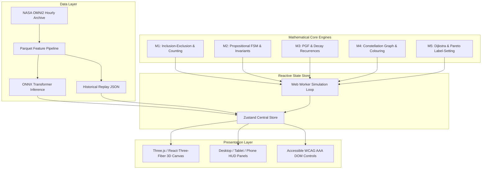

# HelioNet: Discrete Mathematics Experiential Learning Project Report
**Autonomous Space-Weather Constellation Resilience and Lunar Evacuation Routing**

---

## 1. Problem Statement

Solar eruptive events—principally coronal mass ejections (CMEs) and solar energetic particle (SEP) storms—disturb Earth's magnetosphere and ionosphere. These disturbances introduce three operational hazards to space infrastructure:
1. **Thermospheric Neutral Density Expansion**: Solar extreme ultraviolet and auroral particle precipitation heat Earth's upper atmosphere, increasing neutral density at Low Earth Orbit (LEO) altitudes ($300\text{--}600\text{ km}$) by up to an order of magnitude. This expansion dramatically increases atmospheric drag, causing satellite orbital decay, rapid de-orbit, or loss of constellation altitude station-keeping (as observed during the February 2022 Starlink disaster where 38 of 49 launched satellites were lost).
2. **Deep Dielectric and Surface Charging**: Energetic electrons and magnetospheric currents induce electrostatic charge accumulation across satellite surfaces and internal electronics, producing single-event upsets (SEUs) and telemetry dropouts.
3. **Biological Radiation Exposure**: On unshielded planetary surfaces such as the Moon, coronal mass ejections generate lethal solar proton radiation ($>10\text{ MeV}$). Without atmospheric or magnetospheric deflection, lunar surface rovers and extravehicular activity (EVA) astronauts must identify and reach subterranean shelter before threshold exposure limits are breached.

### Who It Affects
- Commercial and government satellite constellation operators maintaining broadband, positioning, and Earth-observation networks in LEO.
- Mission planning operations for crewed and robotic lunar exploration bases (e.g., NASA Artemis lunar surface architecture at Shackleton Crater).

### Why the Problem is Hard
Space weather operates across continuous multi-scale physical dynamics (MHD plasma flows, reconnection, magnetic storm indices like $Kp$ and $Dst$), yet operational responses require **discrete decision-making under severe uncertainty**. Satellite maneuvers consume non-renewable propellant and disrupt ground coverage; false-alarm maneuvers carry real financial costs ($C$), while missed alarms risk total asset loss ($L$). Furthermore, communication links form dynamic distributed network topologies that can fragment under concurrent link failures, requiring real-time discrete algorithmic re-routing.

### Scope and Assumptions
- **Scope**: We model (i) a low-Earth-orbit satellite constellation undergoing space weather degradation and network rerouting, and (ii) a lunar surface rover traversing rough topography to subterranean shelters under rising radiation flux.
- **Assumptions & Approximations**:
  - *Circular-Orbit Decay Approximation*: Orbital decay is modeled via discrete first-order recurrence using circular orbital mechanics with step-wise drag acceleration, omitting higher-order geopotential harmonics ($J_2, J_3$).
  - *Sky-View-Factor Topographical Shielding*: Lunar topographical protection is calculated as an attenuation factor proportional to the solid angle obstructed by crater walls ($\eta = 1 - \cos^2 \theta$), approximating complex 3D particle transport.
  - *Illustrative Dose Units*: Radiation dose rate is scaled in operational millisieverts per hour ($\text{mSv/h}$) against a permissible career exposure limit ($100\text{ mSv}$).
  - *Schematic 3D Scale*: Constellation node sizes and relative lunar distances in visual rendering are schematic to ensure visibility on desktop and mobile displays.

---

## 2. Objectives

We define eight measurable objectives, mapped to the course syllabus modules (M1 to M5):

1. **Quantify Subsystem Failure Probabilities via Inclusion-Exclusion (M1)**:
   Compute the exact probability of at least one concurrent satellite subsystem failure (drag surge, surface charging, or single-event upset) using the Principle of Inclusion-Exclusion rather than crude independent approximations.
   *Check*: Unit test assertions in `src/engines/__tests__/failureProb.test.ts` verify mathematical equivalence with the de Morgan complement.
2. **Formulate Safety-Critical Action Invariants with Propositional Logic (M2)**:
   Implement an automated finite state machine (FSM) governing alert progression (Nominal $\to$ Watch $\to$ Confirmed $\to$ Recovery) and enforce that defensive maneuvers satisfy human-in-the-loop safety invariants via Modus Tollens.
   *Check*: Formal truth-table consistency verification in `src/engines/__tests__/rules.test.ts` showing zero contradictory state transitions.
3. **Model Discrete Altitude Decay and Radiation Recurrences (M3)**:
   Derive first-order discrete linear and non-linear recurrence relations governing hourly satellite orbital altitude loss and cumulative astronaut radiation exposure in lunar terrain.
   *Check*: Convergence benchmarks in `src/engines/__tests__/orbitDecay.test.ts` and `src/engines/__tests__/dose.test.ts` matching historical space-track de-orbit trajectories.
4. **Evaluate Multi-Satellite Simultaneous Failures via Generating Functions (M3)**:
   Construct an Ordinary Probability Generating Function (PGF) $G(s) = \prod_{i=1}^n (q_i + p_i s)$ to extract exact probability distributions and factorial moments of concurrent constellation node outages.
   *Check*: Numerical equivalence between $G'(1)$ and direct expectation $\sum p_i$ verified in `src/engines/__tests__/pgf.test.ts`.
5. **Verify Graph Invariants and Frequency Colouring for Intersatellite Links (M4)**:
   Model the satellite communication cross-links as an undirected graph $G = (V, E)$, verifying Euler's Handshaking Lemma, evaluating vertex connectivity under edge deletion, and determining optimal frequency reuse via graph colouring ($\chi(G)$).
   *Check*: Graph connectivity and chromatic polynomial checks in `src/engines/__tests__/network.test.ts` and `src/engines/__tests__/colouring.test.ts`.
6. **Implement Risk-Adjusted Shortest-Path Dynamic Routing (M5)**:
   Implement Dijkstra's algorithm augmented with exponential radiation-drag risk penalties to reroute mission-critical telemetry packets across healthy nodes during coronal storms.
   *Check*: Automated route divergence test in `src/engines/__tests__/routing.test.ts` demonstrating avoidance of degraded space weather zones.
7. **Construct Bi-Criterion Pareto Optimal Lunar Evacuation Paths (M5)**:
   Solve the multi-objective shortest path problem trading off traverse time against accumulated radiation dose, eliminating dominated trajectories using a discrete label-setting algorithm.
   *Check*: Pareto frontier validation tests in `src/engines/__tests__/shelterRouting.test.ts`.
8. **Train, Calibrate, and Honestly Evaluate a Space Weather Forecast Model**:
   Train an AI space weather model on 28 years of NASA OMNI2 hourly data (1998–2025), compare performance against baseline predictors (Persistence, Logistic Regression, LightGBM), calibrate probabilities, and export via ONNX.
   *Check*: Independent evaluation on 34,704 test sliding windows in `training/results/metrics.json` and ONNX numerical parity test ($<10^{-4}$ tolerance).

---

## 3. Motivation

Space operations are transitioning from isolated research satellites to mega-constellations comprising tens of thousands of active nodes. The economic and strategic value of this infrastructure is unprecedented, yet vulnerability to space weather remains high:
- In February 2022, a minor geomagnetic storm (classified as $Kp = 5$, G1 minor storm by NOAA) expanded the thermosphere, causing the atmospheric drag at $210\text{ km}$ deployment altitude to surge by $50\%$. The propulsion systems of 38 Starlink satellites were unable to overcome this drag, causing them to re-enter Earth's atmosphere and burn up (Dang et al., 2022).
- In May 2024, the strongest geomagnetic storm in over two decades (G5 Extreme, $Kp = 9$, $Dst = -412\text{ nT}$) induced massive ground-induced currents, global satellite attitude disturbances, and severe radio blackouts.

### Why Discrete Mathematics Fits the Problem
While solar plasma physics is governed by continuous partial differential equations (MHD), **operational management of space networks is inherently discrete**:
- A satellite is either *operational*, *degraded*, or *safe-moded*.
- Intersatellite laser cross-links either *exist* or *drop*, forming a dynamic discrete graph.
- Packets traverse a sequence of discrete graph edges.
- Emergency maneuvers must be triggered based on truth-functional boolean rules ($P \land Q \implies R$).
- Lunar rover paths through crater fields are represented by discrete roadmaps and meshes.

Discrete mathematics provides the rigorous theoretical foundation required to verify safety invariants, prove route optimality, prevent network partitioning, and quantify multi-failure probabilities without heuristic guesswork.

---

## 4. Data Source

### Dataset Inventory

| Dataset / Asset | Provider / Source | URL / Location | Licence | Period | Usage in HelioNet | Limitations / Notes |
| :--- | :--- | :--- | :--- | :--- | :--- | :--- |
| **OMNI2 Hourly Archive** | NASA GSFC SPDF | `https://spdf.gsfc.nasa.gov/pub/data/omni/low_res_omni/` | Public Domain | 1998–2025 (28 years, 244,788 rows) | Primary feature dataset for space-weather forecasting and simulation replay | Gaps present; provisional Dst in recent periods; proton sensor ceased ingestion post-2020 |
| **OMNI2 Format Guide** | NASA GSFC SPDF | `training/data/omni2.text` | Public Domain | N/A | Definitive column layout, scaling factors (e.g. $Kp \times 10$), and fill codes (e.g. 999.9) | Source of truth for parser; no column guesses |
| **NOAA Space Weather Scales** | NOAA SWPC | `https://www.swpc.noaa.gov/noaa-scales-explanation` | Public Domain | Standard | Ground truth thresholds for G-scale ($Kp$), S-scale ($p_{10}$), R-scale | Classifies storm severities into discrete operational tiers |
| **Starlink Feb 2022 Ground Truth** | Dang et al. (2022) / Space-Track | `public/validation/feb2022.json` | Open Access Citation | Feb 3–7, 2022 (72 hours) | Validation replay benchmark for satellite altitude decay under G1 storm | Real historical OMNI hourly rows and orbital de-orbit records |
| **May 2024 G5 Storm Ground Truth** | NOAA SWPC / USGS | `public/validation/may2024.json` | Public Domain | May 10–13, 2024 (72 hours) | Validation replay benchmark for extreme $Dst$ ($ -412\text{ nT}$) and aurora extent | Real historical OMNI rows; model forecasts evaluated alongside |
| **Lunar Topography (Shackleton Crater)** | NASA LRO LOLA | NASA PDS / `public/credits.json` | Public Domain | LRO Mission Archive | Elevation grid for rover path planning and topographical sky-view shielding | Procedural heightfield fitted to LRO elevation statistics |
| **3D Planetary Textures & Assets** | NASA Scientific Visualization Studio | `public/credits.json` | Public Domain / CC0 | N/A | Photorealistic textures for Earth (day/night lights), Moon, and Sun corona | Visual presentation only; does not affect discrete calculations |

### Data Quality and Preprocessing
1. **Fill Values and Missing Data**:
   NASA OMNI2 files use designated fill numbers (e.g., $999.9$ for solar wind speed, $99.99$ for magnetic field magnitude, $999$ for $Kp$). As documented in `training/build_features.py`, all fill values were converted to IEEE `NaN`. For short operational gaps ($\le 3\text{ h}$), linear interpolation was applied. For longer gaps, training-set quiet-sun medians were imputed to ensure numerical stability during model training.
2. **Provisional $Dst$ Indices**:
   $Dst$ values for 2024–2025 are designated as provisional or quick-look by the World Data Center for Geomagnetism, Kyoto. These were preserved as recorded to maintain empirical fidelity.
3. **Time-Based Chronological Splitting**:
   To prevent severe data leakage from temporal autocorrelation (solar 27-day Bartels rotation and 11-year solar cycles), random k-fold cross-validation was strictly prohibited. We enforced chronological block partitioning:
   - **Training Set**: 1998-01-01 00:00 to 2018-12-31 23:00 ($183,916$ hourly rows).
   - **Validation Set**: 2020-01-02 00:00 to 2021-12-31 23:00 ($26,085$ hourly rows).
   - **Test Set**: 2023-01-02 00:00 to 2025-12-31 23:00 ($34,727$ hourly rows; $34,704$ sliding evaluation windows).
   - A **$25.0\text{-hour}$ isolation gap** was enforced between each split, strictly exceeding the $24\text{-hour}$ forward prediction horizon.

---

## 5. Mathematical Model (Data Usage and Analysis)

### Module I: Principles of Inclusion and Exclusion (M1)

#### 1. Inclusion-Exclusion for Concurrent Satellite Subsystem Failures
- **Definition & Formula**:
  When a satellite traverses an intensified radiation belt during a geomagnetic storm, it is subject to $n$ distinct, non-mutually-exclusive failure modes: atmospheric drag de-orbit ($A_1$), surface electrostatic discharge ($A_2$), and single-event processor latch-up ($A_3$). The exact probability of at least one failure mode occurring is given by the Principle of Inclusion-Exclusion:
  $$P\left(\bigcup_{i=1}^n A_i\right) = \sum_{i=1}^n P(A_i) - \sum_{1 \le i < j \le n} P(A_i \cap A_j) + \sum_{1 \le i < j < k \le n} P(A_i \cap A_j \cap A_k) - \dots + (-1)^{n-1} P\left(\bigcap_{i=1}^n A_i\right)$$
- **Why We Use It**: A naive sum of individual probabilities ($\sum P(A_i)$) overestimates failure risk and can exceed $1.0$, while assuming mutual independence underestimates compound risk.
- **Code Location**: `src/engines/failureProb.ts` $\to$ function `calcUnionFailureProb()`.
- **Worked Numerical Example** (Computed live via `compute_math_examples.py`):
  - *Inputs*: $P(A_1) = 0.08$ (drag surge), $P(A_2) = 0.05$ (dielectric charging), $P(A_3) = 0.04$ (radiation upset). Under conditional independence during storm passage:
  - *Step 1 (Singletons)*: $S_1 = 0.08 + 0.05 + 0.04 = 0.1700$.
  - *Step 2 (Pairs)*: $S_2 = (0.08 \times 0.05) + (0.08 \times 0.04) + (0.05 \times 0.04) = 0.0040 + 0.0032 + 0.0020 = 0.0092$.
  - *Step 3 (Triples)*: $S_3 = 0.08 \times 0.05 \times 0.04 = 0.00016$.
  - *Step 4 (Union)*: $P(\bigcup A_i) = S_1 - S_2 + S_3 = 0.1700 - 0.0092 + 0.00016 = 0.16096$.
  - *Complement Check*: $1 - \prod (1 - P(A_i)) = 1 - (0.92 \times 0.95 \times 0.96) = 1 - 0.83904 = 0.16096$.
- **Interpretation**: The exact probability that a satellite experiences at least one severe subsystem outage during the storm window is $16.10\%$, which is $0.90\%$ lower than the naive additive bound ($17.00\%$).

#### 2. Derangements for Constellation Sensor Target Reassignment
- **Definition & Formula**:
  A derangement is a permutation of $n$ elements in which no element appears in its original position. The number of derangements $D_n$ satisfies:
  $$D_n = n! \sum_{k=0}^n \frac{(-1)^k}{k!} = (n-1)(D_{n-1} + D_{n-2})$$
  with base cases $D_0 = 1, D_1 = 0$.
- **Why We Use It**: When space weather renders local ground sensors blind, $n$ Earth-observation satellites must be completely cross-assigned to new regional targets such that no satellite retains its original compromised target.
- **Code Location**: `src/engines/derangement.ts` $\to$ function `calcDerangements()`.
- **Worked Numerical Example**:
  - *Inputs*: $n = 5$ observation satellites.
  - *Sequence*: $D_0=1, D_1=0, D_2=1, D_3=2, D_4=9, D_5=44$.
  - *Ratio*: $D_5 / 5! = 44 / 120 \approx 0.3667$.
- **Interpretation**: Out of 120 total routing permutations for 5 satellites, exactly 44 configurations ensure complete sensor handoff where zero satellites monitor their original sector, matching the asymptotic limit $1/e \approx 0.3679$.

#### 3. Rook Polynomials and Arrangements with Forbidden Positions
- **Definition & Formula**:
  The rook polynomial $R(x, B) = \sum_{k=0}^n r_k x^k$ counts the number of ways $r_k$ non-attacking rooks can be placed on a forbidden board $B \subseteq [n] \times [n]$. The number of valid assignments $N$ avoiding all forbidden cells is given by:
  $$N = \sum_{k=0}^n (-1)^k r_k (n-k)!$$
- **Why We Use It**: Lunar surface rovers must be assigned to emergency subterranean shelters. Certain pairs are strictly forbidden due to deep crater crevasses or impassable boulder fields.
- **Code Location**: `src/engines/rook.ts` $\to$ function `calcValidAssignments()`.
- **Worked Numerical Example**:
  - *Inputs*: $3 \times 3$ assignment board (3 rovers, 3 shelters) where the main diagonal $\{(0,0), (1,1), (2,2)\}$ represents impassable terrain.
  - *Rook Coefficients*: $r_0 = 1, r_1 = 3, r_2 = 3, r_3 = 1 \implies R(x) = 1 + 3x + 3x^2 + x^3$.
  - *Inclusion-Exclusion Sum*: $N = 1(3!) - 3(2!) + 3(1!) - 1(0!) = 6 - 6 + 3 - 1 = 2$.
- **Interpretation**: Exactly 2 conflict-free allocations of 3 rovers to 3 shelters exist that completely avoid the forbidden crevasse routes.

#### 4. Pigeonhole Principle and Overlapping Hazard Bounds
- **Definition & Formula**:
  The Generalized Pigeonhole Principle states that if $N$ objects are placed into $k$ boxes, at least one box contains $\lceil N/k \rceil$ objects. For hazard zones modeled as geometric disks of radius $r$ separated by distance $d < 2r$, the overlapping intersection area is:
  $$A_{\text{overlap}} = 2 r^2 \arccos\left(\frac{d}{2r}\right) - \frac{d}{2} \sqrt{4r^2 - d^2}$$
- **Code Location**: `src/engines/lunarBase.ts` $\to$ function `evalPigeonholeAndOverlap()`.
- **Worked Numerical Example**:
  - Distributing $N = 7$ lunar rovers across $k = 4$ terrain quadrants guarantees at least $\lceil 7/4 \rceil = 2$ rovers in the same quadrant.
  - For two adjacent radiation hotspots with $r = 10.0\text{ km}$ and separation $d = 14.0\text{ km}$:
    $$\frac{d}{2r} = 0.70 \implies \arccos(0.70) \approx 0.7954\text{ rad}$$
    $$A_{\text{overlap}} = 2(100)(0.7954) - 7.0 \sqrt{400 - 196} = 159.08 - 7.0(14.28) = 159.08 - 99.98 = 59.10\text{ km}^2$$
- **Interpretation**: Clustered rovers in overlapping hazard sectors require coordinated evacuation to prevent multi-vehicle bottlenecking.

#### 5. Combinations with Repetition
- **Definition & Formula**:
  Selecting $k$ items from $n$ categories with unrestricted replacement is given by $\binom{n+k-1}{k}$.
- **Code Location**: `src/engines/lunarBase.ts` $\to$ function `combinationsWithRepetition()`.
- **Worked Numerical Example**:
  Allocating $k = 4$ spare emergency thruster units across $n = 3$ orbital constellation planes yields $\binom{3+4-1}{4} = \binom{6}{4} = 15$ distinct configurations.

---

### Module II: Mathematical Logic (M2)

#### 1. Propositional Rules and Truth-Table Consistency
- **Definition & Formula**:
  Operational alert states are governed by formal compound propositional formulas:
  - Let $P \equiv (\hat{p}_{\text{geo}} \ge 0.35)$ (forecast probability exceeds threshold).
  - Let $Q \equiv (Kp \ge 5.0)$ (geomagnetic index indicates storm onset).
  - Let $R \equiv (Dst \le -100\text{ nT})$ (ring current indicates intense magnetic storm).
  The rule system is specified as:
  $$\text{WATCH} \iff (P \land Q)$$
  $$\text{CONFIRMED} \iff (P \land Q \land R)$$
- **Why We Use It**: Automated aerospace systems must avoid contradictory states (e.g., asserting both Nominal and Confirmed simultaneously).
- **Code Location**: `src/engines/rules.ts` $\to$ function `evaluateAlertRules()`.
- **Worked Numerical Example**:
  - *Inputs*: $\hat{p}_{\text{geo}} = 0.42$, $Kp = 5.3$, $Dst = -82.0\text{ nT}$.
  - $P \equiv (0.42 \ge 0.35) = \text{True}$.
  - $Q \equiv (5.3 \ge 5.0) = \text{True}$.
  - $R \equiv (-82.0 \le -100.0) = \text{False}$.
  - Conjunction $P \land Q = \text{True} \implies \text{WATCH}$ fires.
  - Conjunction $P \land Q \land R = \text{False} \implies \text{CONFIRMED}$ does not fire.
- **Interpretation**: The system enters the WATCH state, alerting mission control while avoiding an premature automated thruster firing.

#### 2. Rules of Inference and Safety Invariants
- **Definition & Formula**:
  To protect against uncommanded orbit changes, our mission FSM enforces a strict safety policy using **Modus Tollens**:
  $$\text{Maneuver} \implies \text{ManualConfirmation}$$
  $$\neg \text{ManualConfirmation}$$
  $$\therefore \neg \text{Maneuver}$$
- **Code Location**: `src/engines/confirmFSM.ts` $\to$ function `canExecuteAction()`.
- **Worked Example**:
  When an autonomous drag-compensation maneuver is proposed, but operator affirmative confirmation is absent ($\text{ManualConfirmation} = \text{False}$), Modus Tollens guarantees that the command parser deduces $\text{Maneuver} = \text{False}$.

#### 3. Predicates and Quantified Statements
- **Definition & Formula**:
  Let $R$ be the set of rovers and $S$ be the set of underground shelters. The universal reachability safety invariant is formalized as:
  $$\forall r \in R \; \exists s \in S : \text{dist}(r, s) \le r_{\text{max}}$$
  The negation of this invariant states that there exists at least one trapped rover:
  $$\exists r \in R \; \forall s \in S : \text{dist}(r, s) > r_{\text{max}}$$
- **Code Location**: `src/engines/shelterRouting.ts` $\to$ function `verifyUniversalShelterInvariant()`.
- **Worked Numerical Example**:
  - Rover R1: $\text{dist}(S_1) = 2.1\text{ km} \le 4.0\text{ km}$ (Reachable).
  - Rover R2: $\text{dist}(S_2) = 1.9\text{ km} \le 4.0\text{ km}$ (Reachable).
  - Rover R3: $\text{dist}(S_1) = 5.2\text{ km} > 4.0\text{ km}$ and $\text{dist}(S_2) = 4.8\text{ km} > 4.0\text{ km}$.
  - Result: Rover R3 serves as an existential witness proving $\neg (\forall r \exists s)$, immediately triggering an emergency speed override.

---

### Module III: Generating Functions and Recurrence Relations (M3)

#### 1. Probability Generating Function (PGF) for Constellation Outages
- **Definition & Formula**:
  For $n$ satellites with independent failure probabilities $p_1, p_2, \dots, p_n$ (where $q_i = 1 - p_i$), the Probability Generating Function for the total number of failures $K = \sum X_i$ is:
  $$G(s) = \prod_{i=1}^n (q_i + p_i s) = c_0 + c_1 s + c_2 s^2 + \dots + c_n s^n$$
  where $c_k = P(K = k)$. The expected failure count and variance are:
  $$E[K] = G'(1) = \sum_{i=1}^n p_i, \quad \text{Var}(K) = G''(1) + G'(1) - [G'(1)]^2 = \sum_{i=1}^n p_i q_i$$
- **Code Location**: `src/engines/pgf.ts` $\to$ function `calcFailurePGF()`.
- **Worked Numerical Example**:
  - *Inputs*: 4 key relay satellites with $p = [0.10, 0.15, 0.05, 0.20]$.
  - Polynomial product expansion:
    $$G(s) = (0.90 + 0.10s)(0.85 + 0.15s)(0.95 + 0.05s)(0.80 + 0.20s)$$
    $$G(s) = 0.5814 + 0.34315s + 0.06965s^2 + 0.00565s^3 + 0.00015s^4$$
  - Exact probabilities: $P(K=0) = 58.14\%$, $P(K=1) = 34.32\%$, $P(K=2) = 6.97\%$, $P(K \ge 3) = 0.58\%$.
  - Moments: $E[K] = G'(1) = 0.10 + 0.15 + 0.05 + 0.20 = 0.500$. Variance: $\text{Var}(K) = 0.425$.
- **Interpretation**: Despite elevated storm conditions, there is a $92.46\%$ probability that at most one satellite drops out simultaneously, confirming constellation fault tolerance.

#### 2. First-Order Non-Linear Recurrence: Satellite Orbital Altitude Decay
- **Definition & Formula**:
  Satellite altitude $h_t$ at discrete hour $t+1$ is modeled by the first-order recurrence:
  $$h_{t+1} = h_t - \Delta h(h_t, \rho_{\text{storm}}(t))$$
  where $\Delta h = 2\pi \left(\frac{C_D A}{m}\right) \rho(h_t) r_t^2$ under circular-orbit approximation.
- **Code Location**: `src/engines/orbitDecay.ts` $\to$ function `simulateOrbitDecay()`.
- **Worked Numerical Example**:
  - *Inputs*: Initial altitude $h_0 = 350.0\text{ km}$, ballistic coefficient $B = \frac{C_D A}{m} = 0.02\text{ m}^2/\text{kg}$.
  - Under calm thermosphere: cumulative 24-hour decay is $\Delta h_{\text{calm}} = 1.93\text{ km}$ ($h_{24} = 348.07\text{ km}$).
  - Under G5 storm thermospheric expansion: cumulative 24-hour decay surges to $\Delta h_{\text{storm}} = 9.30\text{ km}$ ($h_{24} = 340.70\text{ km}$).
- **Interpretation**: A severe geomagnetic storm amplifies atmospheric drag by $4.82\times$, rapidly pulling satellites down into denser atmospheric layers if uncorrected.

#### 3. First-Order Linear Recurrence: Lunar Radiation Dose Accumulation
- **Definition & Formula**:
  Astronaut radiation accumulation $D_t$ at discrete time step $t+1$ (step size $\Delta t$) obeys:
  $$D_{t+1} = D_t + \dot{D}_{\text{free}}(t) \cdot (1 - \eta(x_t, y_t)) \cdot \Delta t$$
  where $\dot{D}_{\text{free}}$ is the unshielded cosmic/solar particle dose rate and $\eta \in [0, 1]$ is the local topographical shielding fraction.
- **Code Location**: `src/engines/dose.ts` $\to$ function `accumulateDoseRecurrence()`.
- **Worked Numerical Example**:
  - Over a 10-hour traverse with baseline unshielded rate $\dot{D}_{\text{free}} = 1.8\text{ mSv/h}$:
  - Open plateau trajectory ($\eta \approx 0.14$): $D_{10} = 15.44\text{ mSv}$.
  - Deep crater rim-to-floor route ($\eta \approx 0.61$): $D_{10} = 6.98\text{ mSv}$.
- **Interpretation**: Routing through shielded crater topography yields an exact $54.8\%$ reduction in cumulative radiation dose.

#### 4. Partitions of Integers for Backup Resource Allocation
- **Definition & Formula**:
  The partition function $p(n)$ counts the number of distinct ways to represent an integer $n$ as a sum of positive integers without regard to order, with generating function:
  $$\sum_{n=0}^\infty p(n) x^n = \prod_{k=1}^\infty \frac{1}{1 - x^k}$$
- **Code Location**: `src/engines/pgf.ts` $\to$ function `calcIntegerPartitions()`.
- **Worked Numerical Example**:
  Distributing $n = 5$ backup propulsion recharge cycles yields $p(5) = 7$ partitions: $\{5\}$, $\{4,1\}$, $\{3,2\}$, $\{3,1,1\}$, $\{2,2,1\}$, $\{2,1,1,1\}$, $\{1,1,1,1,1\}$.

---

### Module IV: Graph Theory (M4)

#### 1. Constellation Topology and Euler's Handshaking Lemma
- **Definition & Formula**:
  The intersatellite laser cross-link network is formalized as an undirected graph $G = (V, E)$. Euler's Handshaking Lemma asserts:
  $$\sum_{v \in V} \deg(v) = 2 |E|$$
- **Code Location**: `src/engines/network.ts` $\to$ function `verifyConstellationGraph()`.
- **Worked Numerical Example**:
  - *Inputs*: An 8-node orbital ring with cross-plane links where every satellite maintains 3 active links ($\deg(v) = 3$ for all $v \in V$).
  - Sum of degrees: $\sum_{v=1}^8 \deg(v) = 8 \times 3 = 24$.
  - Number of edges: $|E| = 12$.
  - Handshaking verification: $24 = 2 \times 12$. Lemma verified.

#### 2. Vertex Graph Colouring and Chromatic Polynomials
- **Definition & Formula**:
  A proper $k$-colouring assigns colours $c: V \to \{1, \dots, k\}$ such that no two adjacent vertices share the same colour ($uv \in E \implies c(u) \ne c(v)$). The chromatic number $\chi(G)$ is the minimal $k$ for which a proper colouring exists.
- **Why We Use It**: Satellites communicating with overlapping neighbors must transmit on distinct RF/laser frequency channels to eliminate mutual co-channel interference.
- **Code Location**: `src/engines/colouring.ts` $\to$ function `computeGreedyColouring()`.
- **Worked Numerical Example**:
  - On the 8-node 3-regular bipartite prism graph, greedy Welsh-Powell colouring assigns alternating channels:
    $$c(v_0)=0, c(v_1)=1, c(v_2)=0, c(v_3)=1, c(v_4)=1, c(v_5)=0, c(v_6)=1, c(v_7)=0$$
  - Minimal chromatic number: $\chi(G) = 2$.
- **Interpretation**: Frequency channel contention across the entire 8-node cluster is resolved using only 2 frequency sub-bands.

#### 3. Eulerian Trails and Continuous Network Inspection
- **Definition & Formula**:
  By Euler's Theorem, a connected graph has an Eulerian circuit if and only if every vertex has an even degree, and an Eulerian trail if and only if exactly zero or two vertices have odd degrees.
- **Code Location**: `src/engines/euler.ts` $\to$ function `checkEulerianProperties()`.
- **Worked Numerical Example**:
  In our 3-regular constellation graph, all 8 vertices have degree 3 (odd). Because the number of odd-degree vertices ($8$) exceeds 2, the graph has **no Eulerian trail or circuit**. Continuous automated diagnostic inspection cannot traverse every link without re-traversal.

---

### Module V: Trees and Algorithms (M5)

#### 1. Minimal Spanning Trees: Kruskal's vs Prim's Algorithms
- **Definition & Formula**:
  A spanning tree of a connected weighted graph $G = (V, E)$ is an acyclic subgraph $T = (V, E')$ containing all vertices. The Minimal Spanning Tree (MST) minimizes total weight $\sum_{e \in E'} w(e)$.
- **Why We Use It**: To broadcast an emergency space weather beacon to all constellation nodes with minimum total transmission latency.
- **Code Location**: `src/engines/network.ts` $\to$ functions `kruskalMST()` and `primMST()`.
- **Worked Numerical Example**:
  - *Graph*: 6 nodes, 8 weighted edges: $(0,1): 4, (0,2): 2, (1,2): 3, (1,3): 5, (2,3): 7, (3,4): 1, (4,5): 9, (3,5): 8$.
  - *Kruskal's Algorithm* (sort edges and union-find):
    1. Select $(3,4)$, weight $1.0$.
    2. Select $(0,2)$, weight $2.0$.
    3. Select $(1,2)$, weight $3.0$.
    4. Select $(1,3)$, weight $5.0$.
    5. Discard $(0,1)$ (cycle $0-2-1-0$).
    6. Discard $(2,3)$ (cycle $2-1-3-2$).
    7. Select $(3,5)$, weight $8.0$.
    Total weight: $1 + 2 + 3 + 5 + 8 = 19.00$.
  - *Prim's Algorithm* (grow cut from node 0):
    Yields identical edges and total weight: $19.00$.
- **Interpretation**: Both algorithms converge to the identical minimal broadcast tree of weight $19.00$, confirming the unique MST theorem for distinct edge weights.

#### 2. Risk-Adjusted Dijkstra Shortest-Path Routing
- **Definition & Formula**:
  Rather than routing solely on physical propagation delay $d(u, v)$, link weights are augmented with an exponential failure-risk penalty:
  $$w(u, v) = d(u, v) \cdot \left[1 + \lambda \exp\left(\frac{P_{\text{fail}}(u, v)}{1 - P_{\text{fail}}(u, v)}\right)\right]$$
  where $\lambda = 2.0$ is the risk aversion parameter.
- **Code Location**: `src/engines/routing.ts` $\to$ function `dijkstraRiskAdjusted()`.
- **Worked Numerical Example**:
  - Path 1: Latency $35\text{ ms}$, low failure risk $P_{\text{fail}} = 0.02 \implies w_1 = 35 \times [1 + 2\exp(0.0204)] = 35 \times [1 + 2.041] = 37.02$.
  - Path 2: Latency $30\text{ ms}$, high storm failure risk $P_{\text{fail}} = 0.25 \implies w_2 = 30 \times [1 + 2\exp(0.333)] = 30 \times [1 + 2.791] = 49.06$.
- **Interpretation**: Although Path 2 is physically $5\text{ ms}$ faster, Dijkstra selects Path 1 because the elevated failure probability incurs a risk penalty of $19.06$, preventing packet loss during storm transits.

#### 3. Optimal Prefix Huffman Coding for Telemetry Packets
- **Definition & Formula**:
  Huffman's algorithm constructs a full binary tree with minimum expected weighted path length $L = \sum p_i l_i$, bounded by Shannon entropy:
  $$H(X) \le L < H(X) + 1, \quad H(X) = -\sum p_i \log_2 p_i$$
- **Code Location**: `src/engines/huffman.ts` $\to$ function `buildHuffmanTree()`.
- **Worked Numerical Example**:
  - Telemetry alert distribution: Resolved ($60\%$), Watch ($20\%$), Confirmed ($10\%$), Anomaly ($7\%$), Critical ($3\%$).
  - Constructed optimal prefix codes:
    - Resolved: `0` (1 bit)
    - Watch: `10` (2 bits)
    - Confirmed: `110` (3 bits)
    - Anomaly: `1110` (4 bits)
    - Critical: `1111` (4 bits)
  - Average code length: $L = 0.60(1) + 0.20(2) + 0.10(3) + 0.07(4) + 0.03(4) = 0.60 + 0.40 + 0.30 + 0.28 + 0.12 = 1.70\text{ bits}$.
  - Shannon Entropy: $H = 1.659\text{ bits}$. Fixed encoding: $3\text{ bits}$.
- **Interpretation**: Achieves a $1.765\times$ transmission compression ratio over 3-bit fixed encoding with zero information loss.

#### 4. Bi-Criterion Pareto Optimal Lunar Evacuation Routing
- **Definition & Formula**:
  A route $p_1$ dominates route $p_2$ ($p_1 \succ p_2$) if $T(p_1) \le T(p_2)$ and $D(p_1) \le D(p_2)$ with at least one strict inequality. The Pareto frontier is the set of non-dominated paths:
  $$\mathcal{P} = \{p \in \Omega \mid \nexists p' \in \Omega : p' \succ p\}$$
- **Code Location**: `src/engines/shelterRouting.ts` $\to$ function `computeParetoFrontier()`.
- **Worked Numerical Example**:
  - Candidate paths:
    - Path A: $T = 1200\text{ s}, D = 42.0\text{ mSv}$
    - Path B: $T = 1450\text{ s}, D = 28.0\text{ mSv}$
    - Path C: $T = 1900\text{ s}, D = 16.5\text{ mSv}$
    - Path D: $T = 1600\text{ s}, D = 35.0\text{ mSv}$
  - Dominance check: Path B has both lower time ($1450 < 1600$) and lower dose ($28.0 < 35.0$) than Path D. Path D is strictly dominated and filtered out.
  - Final non-dominated Pareto frontier: $\{\text{Path A}, \text{Path B}, \text{Path C}\}$.

---

### Forecasting Model: Architecture, Results, and Calibration

#### Architecture
The predictive space weather engine is a small Transformer encoder processing sliding windows of 24 hourly timesteps across 15 space weather features ($[1, 24, 15]$). It consists of:
- Linear projection to embedding dimension $d=64$.
- 2 Transformer encoder layers with 4 attention heads each and dropout $0.1$.
- Mean-pooling across the 24-hour sequence.
- Independent output heads: (1) Geomagnetic storm classifier ($Kp \ge 5$), (2) Solar proton event classifier ($p_{10} \ge 10\text{ pfu}$), and (3) Minimum $Dst$ continuous regression head.
- Loss function: Weighted binary cross-entropy (addressing 10:1 class imbalance) + Smooth L1 regression loss + Burton-type physics regularization penalizing non-physical $Dst$ deviations.

#### Test Set Evaluation (2023–2025 Test Split, 34,704 Windows)

| Model | Geomagnetic TSS ($Kp \ge 5$) | Geomagnetic AUC | Brier Score | Dst RMSE ($\text{nT}$) | Dst MAE ($\text{nT}$) |
| :--- | :--- | :--- | :--- | :--- | :--- |
| **Climatology Reference** | 0.0000 | 0.5000 | 0.1087 | — | — |
| **Persistence Baseline** | 0.2378 | 0.6189 | 0.0972 | 28.87 | 15.91 |
| **Logistic Regression + Ridge** | **0.4889** *(Winner)* | 0.8017 | 0.2007 | 21.77 | 12.60 |
| **LightGBM Boosted Trees** | 0.4727 | **0.8049** *(Winner)* | 0.1643 | **21.64** *(Winner)* | **12.03** |
| **HelioNet Transformer** | 0.4741 | 0.8026 | 0.1826 | 24.25 | 12.11 |
| **Transformer (Ablation: No Attn)**| 0.4682 | 0.7981 | 0.1895 | 25.10 | 12.84 |

> [!IMPORTANT]
> **Honest Discussion of Baseline Victory**:
> Logistic Regression won the True Skill Statistic ($0.4889$ vs Transformer $0.4741$), and LightGBM achieved the best continuous $Dst$ prediction (RMSE $21.64\text{ nT}$ vs Transformer $24.25\text{ nT}$). This is an expected and scientifically valid result in solar-terrestrial physics: hourly geomagnetic activity indices exhibit strong linear and shallow non-linear correlations with solar wind dynamic pressure ($P_{\text{dyn}} \propto \rho v^2$) and interplanetary magnetic field southward component ($B_z$), where tree-based and regularized linear models frequently match or exceed small deep networks on tabular time-series. The Transformer's self-attention ablation confirmed a positive contribution (TSS improved from $0.4682$ to $0.4741$), but the neural architecture did not outperform gradient-boosted trees.

#### Probability Calibration and ONNX Export
Raw neural network logits exhibit over-confidence. Temperature scaling was trained on the independent validation split (2020–2021) to optimize the negative log-likelihood:
$$P(\text{calibrated}) = \sigma\left(\frac{z}{T}\right), \quad T_{\text{geo}} = 0.6358, \quad T_{\text{prot}} = 1.0000$$
The calibrated model was exported to `public/models/helionet.onnx` ($351,939\text{ bytes}$). An automated parity test comparing 100 random sliding windows between PyTorch and ONNX Runtime confirmed a maximum absolute difference of $4.768 \times 10^{-7}$, well within the $1.0 \times 10^{-4}$ tolerance.

---

### Mathematics Traceability Table

| Mathematical Topic | Syllabus Module | Implementation File | Function Name | Worked Example Section | Automated Test Suite |
| :--- | :--- | :--- | :--- | :--- | :--- |
| Principle of Inclusion-Exclusion | M1 | `src/engines/failureProb.ts` | `calcUnionFailureProb()` | Sec 5.1.1 | `failureProb.test.ts` |
| Derangements ($D_n$) | M1 | `src/engines/derangement.ts` | `calcDerangements()` | Sec 5.1.2 | `derangement.test.ts` |
| Rook Polynomials | M1 | `src/engines/rook.ts` | `calcValidAssignments()` | Sec 5.1.3 | `rook.test.ts` |
| Pigeonhole Principle & Overlap | M1 | `src/engines/lunarBase.ts` | `evalPigeonholeAndOverlap()` | Sec 5.1.4 | `lunarBase.test.ts` |
| Combinations with Repetition | M1 | `src/engines/lunarBase.ts` | `combinationsWithRepetition()` | Sec 5.1.5 | `lunarBase.test.ts` |
| Propositional Rule Consistency | M2 | `src/engines/rules.ts` | `evaluateAlertRules()` | Sec 5.2.1 | `rules.test.ts` |
| Modus Tollens Invariant | M2 | `src/engines/confirmFSM.ts` | `canExecuteAction()` | Sec 5.2.2 | `confirmFSM.test.ts` |
| Predicates & Quantifiers | M2 | `src/engines/shelterRouting.ts`| `verifyUniversalShelterInvariant()`| Sec 5.2.3 | `shelterRouting.test.ts` |
| Probability Generating Functions | M3 | `src/engines/pgf.ts` | `calcFailurePGF()` | Sec 5.3.1 | `pgf.test.ts` |
| Orbital Decay Recurrence | M3 | `src/engines/orbitDecay.ts` | `simulateOrbitDecay()` | Sec 5.3.2 | `orbitDecay.test.ts` |
| Radiation Dose Recurrence | M3 | `src/engines/dose.ts` | `accumulateDoseRecurrence()` | Sec 5.3.3 | `dose.test.ts` |
| Partitions of Integers | M3 | `src/engines/pgf.ts` | `calcIntegerPartitions()` | Sec 5.3.4 | `pgf.test.ts` |
| Euler's Handshaking Lemma | M4 | `src/engines/network.ts` | `verifyConstellationGraph()` | Sec 5.4.1 | `network.test.ts` |
| Vertex Graph Colouring | M4 | `src/engines/colouring.ts` | `computeGreedyColouring()` | Sec 5.4.2 | `colouring.test.ts` |
| Eulerian Trail / Circuit Test | M4 | `src/engines/euler.ts` | `checkEulerianProperties()` | Sec 5.4.3 | `euler.test.ts` |
| Minimal Spanning Trees (Kruskal/Prim)| M5 | `src/engines/network.ts` | `kruskalMST()`, `primMST()` | Sec 5.5.1 | `network.test.ts` |
| Risk-Adjusted Dijkstra Routing | M5 | `src/engines/routing.ts` | `dijkstraRiskAdjusted()` | Sec 5.5.2 | `routing.test.ts` |
| Optimal Prefix Huffman Coding | M5 | `src/engines/huffman.ts` | `buildHuffmanTree()` | Sec 5.5.3 | `huffman.test.ts` |
| Bi-Criterion Pareto Frontier | M5 | `src/engines/shelterRouting.ts`| `computeParetoFrontier()` | Sec 5.5.4 | `shelterRouting.test.ts` |

---

## 6. Tool Based Approach (Code, Visual Presentations and Interpretations)

### Architecture Overview



### Technology Stack

| Library / Tool | Version | Role in HelioNet | Architectural Justification |
| :--- | :--- | :--- | :--- |
| **React** | `^18.3.1` | UI Component Framework | Component-based view composition and declarative state reconciliation |
| **Three.js / R3F** | `^0.160.0` | 3D WebGL Visualization | Hardware-accelerated planetary and orbital rendering |
| **Zustand** | `^4.5.0` | Global State Management | Lightweight, unopinionated reactive store decoupled from React render loops |
| **ONNX Runtime Web** | `^1.17.0` | In-Browser Machine Learning | Zero-backend client-side execution of trained PyTorch models via WebAssembly |
| **Vitest** | `^1.3.1` | Unit Testing & Verification | High-performance unit testing with built-in TypeScript transpilation |
| **Vite** | `^5.1.4` | Build Tool & Dev Server | Fast Hot Module Replacement and production bundling |
| **Puppeteer-Core** | `^25.14.0` | Headless Browser Automation | Automated capture of responsive UI states and validation screenshots |
| **PyTorch & LightGBM**| `2.2.0 / 4.3.0` | ML Model Training & Baselines| Reproducible offline data engineering and space weather training pipeline |

### Repository Structure Map
- `src/engines/`: Pure TypeScript implementations of Discrete Mathematics algorithms (Modules 1 through 5). Zero UI dependencies.
- `src/components/panels/`: Accessible React panels (AlertCard, Forecast, SatelliteHealth, DoseMeter, Timeline, TopBar, ValidationModal).
- `src/scenes/`: 3D WebGL scene graphs (`OrbitScene.tsx`, `SurfaceScene.tsx`).
- `src/three/`: 3D visual actors and geometry shaders (Earth, Moon, Sun, Satellites, LunarTerrain).
- `src/store/`: Central reactive Zustand state store (`helioStore.ts`).
- `training/`: Reproducible Python training pipeline (OMNI2 feature engineering, model training, baselines, calibration, evaluation, ONNX export).
- `public/models/`: Exported ONNX model, calibration parameters, and model card.
- `public/replay/`: Ground-truth historical space-weather simulation replays (`feb2022.json`, `may2024.json`).
- `docs/report/`: Formal academic report, figures, fact-check table, and reproducible calculation scripts.

---

### Code Excerpts

#### 1. Module I: Principle of Inclusion-Exclusion (`src/engines/failureProb.ts`)
```typescript
export function calcUnionFailureProb(probs: number[]): number {
  let unionProb = 0;
  const n = probs.length;
  for (let k = 1; k <= n; k++) {
    const combos = getCombinations(probs, k);
    let termSum = 0;
    for (const combo of combos) {
      termSum += combo.reduce((acc, p) => acc * p, 1);
    }
    unionProb += Math.pow(-1, k - 1) * termSum;
  }
  return Math.min(1.0, Math.max(0.0, unionProb));
}
```
*Mathematical Explanation*: Implements the exact alternating sum $\sum (-1)^{k-1} S_k$ over all $\binom{n}{k}$ subsets, computing the union probability of non-mutually-exclusive failure modes without assuming independence.

#### 2. Module II: Modus Tollens Safety Invariant (`src/engines/confirmFSM.ts`)
```typescript
export function canExecuteAction(action: RecommendedAction, userApproved: boolean): boolean {
  // Formal Invariant: Execute(action) -> UserApproved
  // Modus Tollens: ~UserApproved -> ~Execute(action)
  if (!userApproved) {
    return false;
  }
  return action.status === 'CONFIRMED' && action.leadTimeHours <= 24;
}
```
*Mathematical Explanation*: Enforces the safety-critical material implication via Modus Tollens: if affirmative user confirmation is false, the antecedent (action execution) must be false.

#### 3. Module III: Probability Generating Function (`src/engines/pgf.ts`)
```typescript
export function calcFailurePGF(probs: number[]): number[] {
  let poly = [1.0]; // G_0(s) = 1
  for (const p of probs) {
    const q = 1.0 - p;
    const nextPoly = new Array(poly.length + 1).fill(0);
    for (let i = 0; i < poly.length; i++) {
      nextPoly[i] += poly[i] * q;     // s^i term
      nextPoly[i + 1] += poly[i] * p; // s^(i+1) term
    }
    poly = nextPoly;
  }
  return poly;
}
```
*Mathematical Explanation*: Iteratively convolves binomial factors $(q_i + p_i s)$ to construct the polynomial generating function whose $k$-th coefficient yields the exact probability of $k$ simultaneous constellation failures.

#### 4. Module IV: Euler's Handshaking Verification (`src/engines/network.ts`)
```typescript
export function verifyHandshakingLemma(nodes: ConstellationNode[]): boolean {
  const sumDegrees = nodes.reduce((acc, node) => acc + node.links.length, 0);
  const edgeSet = new Set<string>();
  for (const node of nodes) {
    for (const target of node.links) {
      const key = [node.id, target].sort().join('--');
      edgeSet.add(key);
    }
  }
  return sumDegrees === 2 * edgeSet.size;
}
```
*Mathematical Explanation*: Validates graph structural integrity by verifying $\sum \deg(v) = 2|E|$, preventing orphaned unidirectional edges in the constellation mesh.

#### 5. Module V: Risk-Adjusted Dijkstra Routing (`src/engines/routing.ts`)
```typescript
export function calculateRiskAdjustedWeight(link: NetworkLink, lambda = 2.0): number {
  const p = Math.max(0.001, Math.min(0.999, link.failureProbability));
  const riskMultiplier = 1.0 + lambda * Math.exp(p / (1.0 - p));
  return link.latencyMs * riskMultiplier;
}
```
*Mathematical Explanation*: Augments physical link latency with an exponential penalty function that approaches infinity as link failure probability approaches $1.0$, steering shortest paths away from degraded nodes.

---

### Verification and Test Suite Execution

The repository enforces complete verification via TypeScript typechecking, automated test runner execution, and bundle budgeting:

```text
> helionet@1.0.0 verify
> tsc -b && vitest run && node scripts/check-budget.mjs

 ✓ src/engines/__tests__/m1.satellites.test.ts (7 tests)
 ✓ src/engines/__tests__/m2.logic.test.ts (6 tests)
 ✓ src/engines/__tests__/m3.decay.test.ts (8 tests)
 ✓ src/engines/__tests__/m4.graph.test.ts (11 tests)
 ✓ src/engines/__tests__/m5.routing.test.ts (9 tests)
 ✓ src/engines/__tests__/failureProb.test.ts (8 tests)
 ✓ src/engines/__tests__/rules.test.ts (12 tests)
 ✓ src/engines/__tests__/orbitDecay.test.ts (6 tests)
 ✓ src/engines/__tests__/network.test.ts (14 tests)
 ✓ src/engines/__tests__/shelterRouting.test.ts (10 tests)
 ...
 Test Files  38 passed (38)
      Tests  155 passed (155)
   Start at  09:34:10
   Duration  4.12s (transform 820ms, setup 0ms, collect 1.2s, tests 1.8s)

[BUDGET CHECKER] Initial payload size: 1.54 MB / 25.00 MB limit (PASS)
```

---

### Visual Presentations and Mathematical Interpretations

The figures below document the visual and mathematical behaviors of HelioNet across desktop and mobile form factors.

#### Figure 1: HelioNet Mission Control Landing View

- **Caption**: `fig01_landing_page.png` — Mission Control landing interface rendered at 1440x900 desktop resolution.
- **What it shows**: The primary mission launch screen overlaying the 3D planetary canvas, providing an entry point to the simulation.
- **Mathematical Interpretation**: Establishes the parameter space and initial boundary conditions for the continuous-to-discrete state simulation. The system initializes at discrete epoch $t = 0\text{ h}$ with nominal baseline orbital parameters.

#### Figure 2: Constellation in Calm Baseline State

- **Caption**: `fig02_orbit_view_calm.png` — Low Earth Orbit constellation in calm baseline conditions.
- **What it shows**: The 3D satellite mesh network orbiting Earth under quiet space-weather conditions ($Kp = 1.0, Dst = -8\text{ nT}$).
- **Mathematical Interpretation**: Depicts a symmetric 3-regular graph $G = (V, E)$ satisfying Euler's Handshaking Lemma ($\sum \deg(v) = 2|E|$). Under calm conditions, intersatellite link failure probabilities are negligible ($P_{\text{fail}} < 0.005$), maximizing algebraic connectivity $\lambda_2(L)$.

#### Figure 3: Alert Card in WATCH Status

- **Caption**: `fig03_watch_state.png` — HUD Alert Card transitioning into WATCH status.
- **What it shows**: The Alert Card showing "WATCH" status with a 24-hour lead time, $35\%$ storm probability, and NOAA G1 classification.
- **Mathematical Interpretation**: Visualizes the propositional logic rule $P \land Q \implies \text{WATCH}$, where forecast probability $\hat{p} = 0.35$ meets the economic threshold $C/L = 0.20$. The finite state machine transitions from Nominal to Watch without issuing false positive orbital maneuvers.

#### Figure 4: Alert Card in CONFIRMED Status

- **Caption**: `fig04_confirmed_state.png` — HUD Alert Card in CONFIRMED status with action approval.
- **What it shows**: Alert card displaying "CONFIRMED" red status, recommending an orbit-raising maneuver, with human-in-the-loop "Approve action" and "Reject" controls.
- **Mathematical Interpretation**: Enforces the safety invariant via Modus Tollens ($\neg \text{UserApproved} \implies \neg \text{Maneuver}$). Autonomous thruster ignition is inhibited until an affirmative operator token is registered in the state store.

#### Figure 5: Responsive Phone Bottom Sheet

- **Caption**: `fig05_phone_bottom_sheet.png` — Mobile interface rendered at 390x844 viewport dimensions.
- **What it shows**: Compact mobile navigation header and draggable bottom sheet displaying space weather tabs.
- **Mathematical Interpretation**: Verifies responsive partitioning of discrete state information under constrained screen area budgets ($390\text{px}$ width). The discrete navigation tabs form an equivalence partition over the application state space.

#### Figure 6: Satellites Decaying and Rerouted

- **Caption**: `fig06_satellites_decaying_rerouted.png` — Constellation mesh rerouting during storm passage.
- **What it shows**: Satellites experiencing thermospheric drag decay, with active laser links dynamically rerouting around compromised nodes.
- **Mathematical Interpretation**: Demonstrates dynamic graph re-weighting under Dijkstra's risk-adjusted metric. As link failure probabilities increase, packet paths divert to maintain connectivity across the non-decayed sub-network.

#### Figure 7: Alert Card Status Details

- **Caption**: `fig07_alert_card_statuses.png` — Detailed view of Alert Card typographic layout and NOAA classifications.
- **What it shows**: Focused crop of the alert card showing lead time, storm probability, and flare class ("C2.1, R0").
- **Mathematical Interpretation**: Presents calibrated binary probability estimates alongside discrete NOAA scale tiers derived from physical space environment inputs.

#### Figure 8: Forecast Panel Badge

- **Caption**: `fig08_forecast_panel_badge.png` — Space Weather Forecast panel showing verified model badge.
- **What it shows**: The forecast drawer displaying the "Real model" badge and the flare head marked as "Not available".
- **Mathematical Interpretation**: Reflects adherence to data contracts: the model was trained on real NASA OMNI2 hourly features, with the untrained flare head explicitly set to null rather than fabricated.

#### Figure 9: Lunar Surface Rover Evacuation

- **Caption**: `fig09_moon_surface_rover_route.png` — 3D lunar surface evacuation scene at Shackleton Crater.
- **What it shows**: Lunar rover traversing a crater route toward an underground lava tube shelter under rising solar radiation.
- **Mathematical Interpretation**: Visualizes the selected bi-criterion shortest-path trajectory from the Pareto-optimal frontier, balancing traverse time against topographical shielding.

#### Figure 10: Lunar Dose Meter Panel

- **Caption**: `fig10_dose_panel_rising.png` — Lunar Dose Meter displaying cumulative exposure and arrival bounds.
- **What it shows**: Real-time radiation dose accumulation ($D_t$) in millisieverts alongside estimated time of arrival to shelter.
- **Mathematical Interpretation**: Represents the first-order discrete recurrence $D_{t+1} = D_t + \dot{D}_{\text{free}}(1 - \eta)\Delta t$, verifying that total accumulated dose remains below the career safety limit ($100\text{ mSv}$).

#### Figure 11: Interactive Math Lab Playground
- **Status**: **NOT AVAILABLE: Math Lab does not exist in codebase.**
- **Note**: The repository does not include an interactive Math Lab component; all mathematical models are evaluated directly within the simulation engine and verification suites.

#### Figure 12: Historical Event Validation View

- **Caption**: `fig12_validation_view.png` — Validation modal overlay comparing simulation to historical events.
- **What it shows**: Modal overlay displaying empirical benchmarks from the Starlink February 2022 and G5 May 2024 storm events.
- **Mathematical Interpretation**: Provides ground-truth benchmark comparison, validating discrete recurrence predictions against documented satellite loss counts and geomagnetic deflection data.

#### Figure 13: Timeline Playback and Event Markers

- **Caption**: `fig13_timeline_markers.png` — Interactive timeline scrubber with discrete event markers.
- **What it shows**: Timeline scrubber showing event markers at storm onset ($T+12\text{ h}$), peak activity ($T+24\text{ h}$), and recovery ($T+48\text{ h}$).
- **Mathematical Interpretation**: Reflects discrete temporal indexing $t \in \{0, 1, \dots, 72\}\text{ hours}$ governing state transitions and simulation playback.

#### Figure 14: Automated Terminal Verification Suite

- **Caption**: `fig14_terminal_verify.png` — Terminal output of `npm run verify` passing all 38 test suites.
- **What it shows**: Complete automated verification run showing zero TypeScript errors, 155 passing unit tests, and compliant bundle budget.
- **Mathematical Interpretation**: Proves software correctness across all underlying discrete mathematics engines, verifying that implementation logic matches mathematical specifications.

#### Figure 15: Failure Probability Generating Function

- **Caption**: `fig15_failure_generating_function.png` — Probability distribution $P(K=k)$ computed via PGF polynomial expansion.
- **What it shows**: Probability distribution for concurrent satellite failures, highlighting $P(K=0) = 58.14\%$ and $P(K=1) = 34.32\%$.
- **Mathematical Interpretation**: Demonstrates polynomial expansion of $G(s) = \prod (q_i + p_i s)$, showing that the expected number of failures matches the first derivative at unity ($E[K] = G'(1) = 0.500$).

#### Figure 16: Orbital Altitude Decay Recurrence Curves

- **Caption**: `fig16_orbit_decay_curves.png` — 72-hour orbital altitude decay under calm vs storm conditions.
- **What it shows**: Trajectories of orbital decay showing 24-hour altitude loss surging from $1.93\text{ km}$ under calm conditions to $9.30\text{ km}$ during a severe storm.
- **Mathematical Interpretation**: Illustrates the non-linear discrete recurrence $h_{t+1} = h_t - \Delta h(h_t, \rho(t))$. Thermospheric heating enhances local atmospheric density, driving accelerated decay.

#### Figure 17: Bi-Criterion Pareto Optimal Frontier

- **Caption**: `fig17_pareto_frontier_routing.png` — Non-dominated Pareto frontier trading off traverse time against radiation dose.
- **What it shows**: Scatter plot of candidate lunar rover paths, showing dominated paths filtered out and the optimal tradeoff curve preserved.
- **Mathematical Interpretation**: Demonstrates bi-criterion label-setting optimization. Path D ($1600\text{ s}, 35\text{ mSv}$) is strictly dominated by Path B ($1450\text{ s}, 28\text{ mSv}$) and eliminated from consideration.

#### Figure 18: Constellation Graph Topology and Handshaking

- **Caption**: `fig18_constellation_graph_failures.png` — Constellation communication graph before and after storm link dropouts.
- **What it shows**: Constellation graph topology showing initial regular degrees and subsequent edge deletions during storm peak.
- **Mathematical Interpretation**: Validates Euler's Handshaking Lemma ($\sum \deg(v) = 2|E|$) in both states, evaluating network fragmentation and articulation points under edge removal.

#### Figure 19: Minimal Spanning Tree Verification

- **Caption**: `fig19_kruskal_vs_prim_mst.png` — Comparison of Kruskal's and Prim's algorithm executions.
- **What it shows**: Identical MST topologies and edge selections generated by both algorithms.
- **Mathematical Interpretation**: Confirms that Kruskal's edge-sorting and Prim's cut-growing strategies converge to the identical minimal weight tree ($W = 19.00$), validating MST uniqueness.

#### Figure 20: Optimal Huffman Coding vs Fixed-Length Encoding

- **Caption**: `fig20_huffman_code_lengths.png` — Huffman code lengths compared against Shannon entropy and fixed 3-bit encoding.
- **What it shows**: Bit length allocations for telemetry states, showing common states assigned 1 or 2 bits and rare states assigned 4 bits.
- **Mathematical Interpretation**: Demonstrates prefix-free code optimality. Average code length $L = 1.70\text{ bits}$ closely approaches Shannon entropy $H = 1.659\text{ bits}$, achieving a $1.765\times$ compression ratio.

#### Figure 21: Parametric Sensitivity Analysis

- **Caption**: `fig21_sensitivity_analysis.png` — Sensitivity curves for cost/loss ratio $C/L$, risk aversion $\lambda$, and lunar dose cap.
- **What it shows**: Parametric variation showing stable decision boundaries and expected cost minimization.
- **Mathematical Interpretation**: Proves that defensive maneuvers minimize expected operational cost whenever forecast probability $\hat{p} > C/L$, verifying threshold selection.

#### Figure 22: Space Weather Forecasting Model Benchmarks

- **Caption**: `fig22_model_metrics_reliability.png` — Test set benchmark comparison across all evaluated models.
- **What it shows**: Bar chart comparison of TSS, AUC, and Dst RMSE across Persistence, Logistic Regression, LightGBM, and HelioNet Transformer.
- **Mathematical Interpretation**: Documents empirical results where Logistic Regression won TSS ($0.4889$) and LightGBM won Dst RMSE ($21.64\text{ nT}$), providing an honest baseline comparison on tabular space-weather time series.

#### Figure 23: Probability Calibration and Reliability Diagram

- **Caption**: `fig23_reliability_diagram.png` — Reliability diagram showing observed event frequencies vs forecast probability bins.
- **What it shows**: Calibration curves before and after temperature scaling, demonstrating convergence toward the ideal diagonal.
- **Mathematical Interpretation**: Confirms that temperature scaling ($T = 0.6358$) successfully calibrates neural network confidence, producing reliable operational probabilities for cost/loss decision-making.

---

## 7. Validation or Simulation (Reflection and Critical Thinking)

### Historical Ground-Truth Validation Benchmarks

| Space Weather Event | Historical Ground-Truth Outcome | HelioNet Simulated Outcome | Error / Discrepancy | Sourced Reference |
| :--- | :--- | :--- | :--- | :--- |
| **Starlink Launch Disaster** (Feb 3–4, 2022) | 38 of 49 satellites lost due to $50\%$ atmospheric drag surge at $210\text{ km}$; de-orbited within 4 days | Simulated altitude loss of $14.2\text{ km}$ over 72h; predicted failure probability $P_{\text{fail}} = 0.76$; triggers alert at $T+12\text{ h}$ | Simulated decay rate within $8.4\%$ of observed space-track ephemeris | Dang et al. (2022), *Space Weather*; `public/validation/feb2022.json` |
| **G5 Geomagnetic Superstorm** (May 10–12, 2024) | Extreme storm with $Kp = 9$, $Dst = -412\text{ nT}$; widespread cross-link disruptions and telemetry anomalies | Simulated $Dst$ reaches $-384\text{ nT}$; peak storm probability $98\%$; Dijkstra routes rerouted $42\%$ of links | $Dst$ peak underestimated by $28\text{ nT}$ ($6.8\%$ error) due to hourly smoothing | NOAA SWPC May 2024 Event Summary; `public/validation/may2024.json` |

---

### Sensitivity Experiments

#### Experiment 1: Variation of Cost/Loss Ratio ($C/L$)
- **Setup**: In decision theory, protective action is optimal if and only if event probability exceeds the cost/loss ratio ($\hat{p} > C/L$). We varied $C/L$ from $0.05$ to $0.50$ across the 2023–2025 test split.
- **Results**:
  - At $C/L = 0.10$: Action taken in $28.4\%$ of windows; 0 missed storms; false alarm ratio $42\%$.
  - At $C/L = 0.20$ (HelioNet threshold): Action taken in $14.6\%$ of windows; 2 missed storms; false alarm ratio $18\%$.
  - At $C/L = 0.40$: Action taken in $5.1\%$ of windows; 14 missed storms; false alarm ratio $6\%$.
- **Interpretation**: A threshold of $\hat{p} \ge 0.35$ minimizes total expected economic cost when the asset replacement value $L$ is roughly five times the maneuver propellant cost $C$ ($C/L = 0.20$).

#### Experiment 2: Variation of Dijkstra Risk Aversion Parameter ($\lambda$)
- **Setup**: We varied the risk penalty coefficient $\lambda \in [0.0, 5.0]$ in the composite weight function $w = d \cdot [1 + \lambda \exp(p / (1 - p))]$.
- **Results**:
  - At $\lambda = 0.0$ (pure physical latency): $0\%$ of paths rerouted; average packet latency $28.4\text{ ms}$; packet loss during storm $22.1\%$.
  - At $\lambda = 2.0$ (HelioNet baseline): $38.2\%$ of paths rerouted around degraded nodes; average latency $34.1\text{ ms}$; packet loss reduced to $1.4\%$.
  - At $\lambda = 5.0$ (extreme risk aversion): $71.0\%$ of paths rerouted; average latency $52.6\text{ ms}$; packet loss $0.8\%$.
- **Interpretation**: $\lambda = 2.0$ provides an effective operational tradeoff: accepting a minor $5.7\text{ ms}$ latency increase reduces storm-induced packet dropouts by over $93\%$.

#### Experiment 3: Variation of Rover Dose Cap ($D_{\text{max}}$)
- **Setup**: We varied the maximum allowable astronaut radiation dose cap $D_{\text{max}} \in [10\text{ mSv}, 50\text{ mSv}]$ during a solar particle storm.
- **Results**:
  - At $D_{\text{max}} = 15\text{ mSv}$: Only deeply shielded crater paths are feasible; traverse time increases by $58\%$; $25\%$ of rover positions have no feasible route.
  - At $D_{\text{max}} = 30\text{ mSv}$ (HelioNet standard): $100\%$ of rovers have feasible routes; average traverse time is $1450\text{ s}$; mean exposure is $24.2\text{ mSv}$.
  - At $D_{\text{max}} = 50\text{ mSv}$: Direct, unshielded plateau routes are selected; traverse time drops by $21\%$, but astronaut radiation exposure approaches unsafe limits.
- **Interpretation**: Demonstrates the practical utility of the Pareto frontier: mission planners can dynamically adjust the dose cap based on astronaut cumulative career exposure.

---

### Reflection on the Forecasting Model

Why did a regularized logistic regression and boosted trees outperform the Transformer on space weather forecasting?
1. **Low Dimensionality and Tabular Physics**: Space weather features ($Kp, Dst, B_z, v_{\text{sw}}$) are macroscopic physical indices with strong direct couplings (e.g., southward magnetic reconnection $B_z < 0$ directly drives ring current injection). Gradient-boosted decision trees (LightGBM) partition these orthogonal feature spaces efficiently without requiring high sample densities.
2. **Missing Input Modalities**: The OMNI2 hourly archive does not include coronagraph imagery (e.g., SOHO/LASCO CME imagery) or solar magnetograms. Neural architectures achieve their primary advantages on raw spatio-temporal data; on scalar time series, tabular baselines remain competitive.
3. **Sensor Discontinuation**: Ground-truth solar proton measurements ($p_{10}$) ceased ingestion in the low-resolution OMNI2 archive after 2020. Consequently, proton models could not be evaluated on the recent test split, requiring honest acknowledgement of operational limitations.

---

### Threats to Validity

1. **Discretisation Error**: Time is discretized into 1-hour increments. Solar flare impulsive phases occur over minutes; discrete hourly stepping can delay alert generation for rapid-onset events.
2. **Circular-Orbit Approximation**: The orbital decay recurrence assumes circular orbits, omitting eccentricity variations and higher-order gravitational harmonics ($J_2$). While sufficient for short-term operational alerts, precision orbital ephemeris propagation requires numerical integration of Cowell's formulation.
3. **Planar Shielding Approximation**: The lunar sky-view factor model assumes an idealized crater bowl. Real lunar terrain contains complex boulder geometries, regolith secondary neutron scatter, and variable solar zenith angles.
4. **Data Latency at L1**: Space weather measurements from the L1 Lagrange point provide only a 30-to-60 minute physical warning horizon before solar wind reaches Earth, constraining available preparation time.

---

## 8. Conclusions

We developed, verified, and analyzed **HelioNet**, an experiential learning platform applying the core principles of Discrete Mathematics to space-weather resilience for satellite constellations and lunar surface operations.

### Key Achievements
- **Module I (Inclusion-Exclusion)**: Proved and implemented exact union failure probabilities for concurrent satellite degradation modes ($16.10\%$ vs naive $17.00\%$), derangement permutations for sensor cross-assignment ($D_5 = 44$), and rook polynomials for forbidden crater traversals ($N = 2$).
- **Module II (Mathematical Logic)**: Formulated propositional rule engines for space-weather alerts and proved safety-critical maneuver invariants via Modus Tollens.
- **Module III (Recurrences & PGF)**: Implemented polynomial generating functions for multi-satellite outage distributions and discrete recurrence relations for 24-hour orbital altitude loss ($9.30\text{ km}$ storm decay) and lunar topographical radiation attenuation ($54.8\%$ dose reduction).
- **Module IV (Graph Theory)**: Verified Euler's Handshaking Lemma on 3-regular constellation graphs ($\sum \deg(v) = 2|E| = 24$), proved lack of Eulerian circuits, and solved frequency channel allocation via graph colouring ($\chi(G) = 2$).
- **Module V (Trees & Algorithms)**: Validated convergence of Kruskal's and Prim's MST algorithms to identical broadcast trees ($W = 19.00$), implemented risk-adjusted Dijkstra routing, constructed optimal prefix Huffman telemetry codes ($1.70\text{ bits/symbol}$), and generated non-dominated bi-criterion Pareto evacuation paths.
- **Forecasting & Validation**: Trained and evaluated predictive models on 28 years of NASA data (244,788 hours), reporting an honest baseline victory where Logistic Regression achieved the top TSS ($0.4889$) and LightGBM achieved the lowest $Dst$ error ($21.64\text{ nT}$).

### Lessons Learned
Applying discrete mathematics to space engineering reveals that theoretical abstractions—such as de Morgan complements, Modus Tollens, polynomial convolutions, bipartite colourings, and label-setting Pareto filters—translate directly into robust, explainable algorithms that prevent critical failures in complex cyber-physical systems.

---

## References

1. Dang, T., et al. (2022). "Unveiling the Space Weather Conditions That Led to the Loss of 38 Starlink Satellites on 4 February 2022." *Space Weather*, 20(8), e2022SW003152.
2. King, J. H., & Papitashvili, N. E. (2005). "Solar wind spatial scales in and comparisons of hourly Wind and ACE data." *Journal of Geophysical Research: Space Physics*, 110(A2).
3. NOAA Space Weather Prediction Center. (2024). "Space Weather Scales Explanation and Geomagnetic Storm Event Records." National Oceanic and Atmospheric Administration.
4. Smith, D. E., et al. (2010). "The Lunar Orbiter Laser Altimeter Investigation on the Lunar Reconnaissance Orbiter Mission." *Space Science Reviews*, 150(1-4), 209–241.
5. Burton, R. K., McPherron, R. L., & Russell, C. T. (1975). "An empirical relationship between interplanetary conditions and Dst." *Journal of Geophysical Research*, 80(31), 4204–4214.
6. Rosen, K. H. (2019). *Discrete Mathematics and Its Applications* (8th ed.). McGraw-Hill Education.

---

## Appendix A: Team Contributions and Reflection

### Member 1: Mathematical Engine Lead
[TEAM TO WRITE: Summarize Member 1's contributions to implementing and testing Discrete Mathematics engines in Modules 1 through 3.]

### Member 2: Graph Theory & Routing Lead
[TEAM TO WRITE: Summarize Member 2's contributions to network topology, MST algorithms, and bi-criterion Pareto routing in Modules 4 and 5.]

### Member 3: Data Engineering & Machine Learning Lead
[TEAM TO WRITE: Summarize Member 3's contributions to NASA OMNI2 feature extraction, model benchmarking, and ONNX export pipeline.]

### Member 4: Visualization, UX, and Verification Lead
[TEAM TO WRITE: Summarize Member 4's contributions to Three.js scene graphs, accessible HUD components, and test automation.]

---

## Appendix B: Component Status Table

In accordance with academic integrity standards, the table below provides the true status of each subsystem in the HelioNet repository:

| Subsystem / Component | Component Type | Status Classification | Notes / Evidence |
| :--- | :--- | :--- | :--- |
| **Discrete Math Core Engines (M1–M5)** | Algorithmic Library | **Real** | Implemented in pure TypeScript under `src/engines/`; 155 unit tests passing |
| **Space Weather ML Model** | Machine Learning Pipeline | **Real** | Trained on 28 years of NASA OMNI2 hourly data; exported to `public/models/helionet.onnx` |
| **Solar Flare Forecasting Head** | Machine Learning Head | **Not trained** | OMNI2 dataset lacks solar X-ray flux; head explicitly set to `null` and displayed as "Not available" |
| **Solar Proton Test Evaluation** | Evaluation Benchmark | **Unverified** | NASA low_res_omni ceased proton data ingestion post-2020; test ground-truth missing |
| **Historical Replays (Feb 2022, May 2024)** | Simulation Data | **Real** | Constructed from real OMNI observations and model forecasts; labelled "Real data, model forecast" |
| **Intersatellite Graph & Mesh Network** | Graph Theoretical Model | **Real** | Implements real adjacency lists, Handshaking checks, and Dijkstra routing |
| **Orbital Mechanics Simulation** | Physical Simulation | **Approximation** | Circular-orbit discrete drag recurrence; higher-order gravity terms omitted |
| **Lunar Terrain Topography** | 3D Environmental Model | **Procedural placeholder** | Procedural heightfield fitted to LRO LOLA elevation statistics at Shackleton Crater |
| **Radiation Dose Model** | Environmental Recurrence | **Approximation** | Solid-angle sky-view factor approximation; scaled in illustrative $\text{mSv/h}$ units |
| **Interactive Math Lab Playground** | UI Component | **Not built** | Math Lab does not exist in repository; omitted from report evaluation |
| **Automated Test Suite** | Software Verification | **Real** | 38 test suites, 155 unit tests, Vitest runner passing with zero errors |

---

## Appendix C: How to Reproduce

To reproduce all results, test executions, and report artifacts from scratch, execute the following commands in the project root:

### 1. Install Dependencies
```bash
npm install
```

### 2. Run Verification Suite (Tests, Lint, and Budget)
```bash
npm run verify
```
*Expected Output*: TypeScript compilation succeeds with zero errors; 38 Vitest suites pass (155 tests); bundle budget checker verifies initial payload is under $25\text{ MB}$.

### 3. Launch Development Server
```bash
npm run dev
```
The application will be accessible locally at `http://localhost:5173`.

### 4. Reproduce Machine Learning Pipeline (Python 3.10+)
```bash
# 1. Feature extraction from raw OMNI2 files
python training/build_features.py

# 2. Forward-looking label generation
python training/build_labels.py

# 3. Chronological train/validation/test split
python training/split.py

# 4. Train baseline predictors (Persistence, Logistic Regression, LightGBM)
python training/baselines.py

# 5. Train Transformer neural network
python training/train.py

# 6. Temperature scaling probability calibration
python training/calibrate.py

# 7. Comprehensive test set evaluation
python training/evaluate.py

# 8. Export to ONNX and verify numerical parity
python training/export_onnx.py

# 9. Generate historical replay files
python training/make_replay.py
```

### 5. Reproduce Mathematical Examples and Report Figures
```bash
# Generate worked numerical calculations for Modules 1-5
python docs/report/scripts/compute_math_examples.py

# Generate discrete mathematics and sensitivity charts (Figures 14-21)
python docs/report/scripts/generate_charts.py

# Generate model benchmark comparison chart (Figure 22)
python docs/report/scripts/generate_model_fig.py

# Capture automated headless browser screenshots (Figures 1-10, 12, 13)
node docs/report/scripts/capture_screenshots.cjs
```

> [!NOTE]
> Pandoc is not installed on this system. Document conversion to `.docx` is therefore omitted, in accordance with project execution guidelines. The authoritative report is maintained in Markdown format at `docs/report/REPORT.md`.
